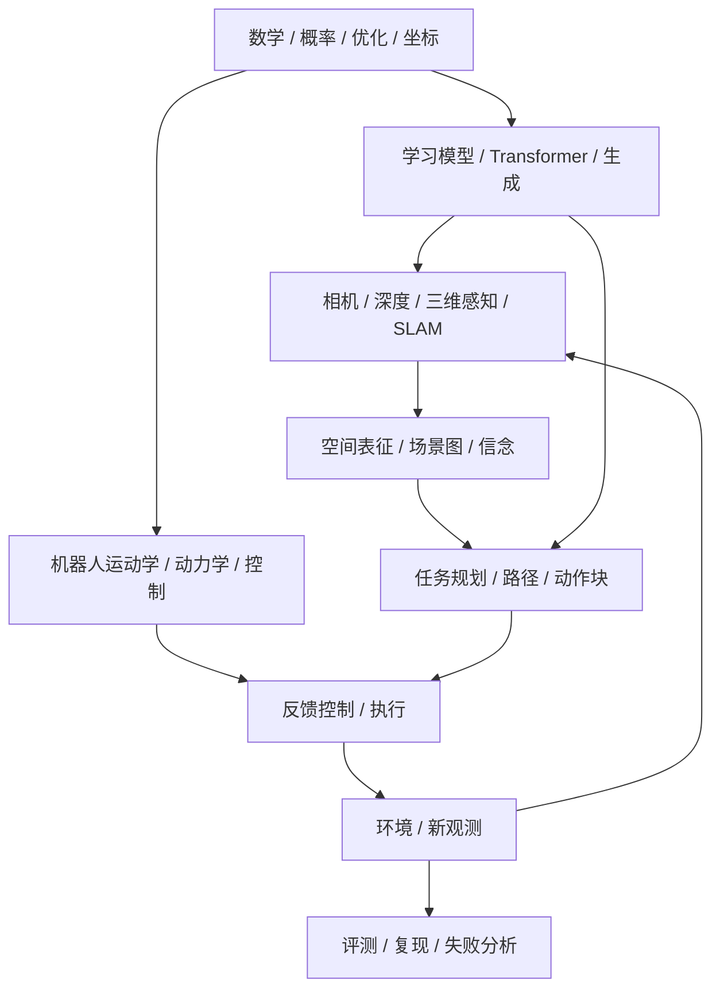

# 00 · 知识地图与学习路线（导读）

## 1. 从一个机器人任务看完整知识链
任务：“把桌上的红色杯子放入水槽。”
1. 语言理解把命令拆成目标对象“红杯”和目标区域“水槽”。
2. 视觉感知检测杯子/水槽，深度估计它们的位置。
3. 坐标几何把相机坐标下的物体位姿变换到机器人基座坐标。
4. 空间推理验证杯子是否在桌面、目标槽是否可达、路径有无障碍。
5. 操作规划生成接近、抓取、抬起、移动、放置动作。
6. 控制器将轨迹转成关节命令，传感器反馈修正实际误差。
7. 新观测确认是否抓稳和放置成功；失败时重新定位和规划。

这条链说明 AI、机器人学和空间智能的分工：语言模型提供语义泛化，几何模块提供可测量空间，规划控制提供可执行动作，闭环传感器避免把开环预测当事实。

## 2. 模块之间的依赖图

若从机器学习切入，可优先学 01、02、04、06；若从机械臂实验切入，优先学 01、03、04、06；若研究空间推理，优先学 01、04、05、08。

## 3. 按研究目标选学习模块

|研究问题|需要先掌握|典型输入→输出|常见基线|
|---|---|---|---|
|空间问答|相机几何、对象检测、关系定义|图像/场景→距离或关系|几何计算、VLM|
|移动导航|SLAM、占据图、A*/局部规划|激光/相机→速度命令|A*、DWA/MPC|
|桌面抓取|深度、手眼标定、IK、碰撞|RGB-D→抓取轨迹|几何抓取、行为克隆|
|动作生成|概率建模、BC、扩散/流|观测+演示→动作块|高斯BC、Diffusion Policy|
|世界模型|状态表示、时序预测、MPC|历史状态/动作→未来状态|解析动力学、单步预测|
|训练部署|显存、吞吐、延迟 profiling|模型/任务→可运行系统|精度/并行/缓存优化|

## 4. 学习成果应该是什么
- 能写明符号、坐标系、单位和维数，而不是只背公式。
- 能从概率模型/几何关系推到训练或估计目标，知道每一步用了什么假设。
- 能画出数据路径、训练路径和在线执行路径。
- 能用一个小数值例子验证公式，再用真实数据检查误差和异常。
- 能区分“模型看起来合理”和“机器人执行安全/成功”。

## 5. 符号与知识边界
同一字母可能跨领域复用：β 在扩散中常表示噪声日程，在损失中又可作正则系数；λ 可作像素投影尺度也可作优化权重。阅读时看章节定义、维数和单位。涉及具体 GPU、模型排名、基准分数、商业产品状态时，需要查当前官方规格/论文版本。
