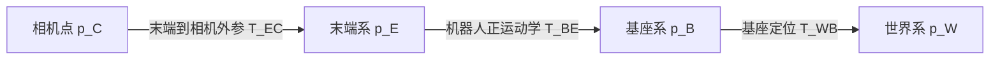
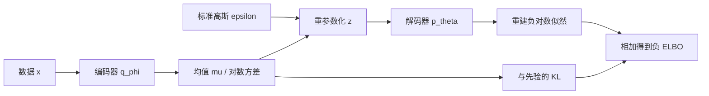

# 01 · 数学、概率与坐标变换

> 阅读目标：从最小二乘和概率分布出发，掌握 KL、ELBO、刚体变换和相机投影。约定实向量为列向量，正文中 token 特征按行存放；所有 log 均为自然对数。

## 1. 符号与维数

|符号|含义|维数 / 条件|
|---|---|---|
|$x,A,b$|未知量、设计矩阵、测量|$x\in\mathbb R^n,A\in\mathbb R^{m\times n},b\in\mathbb R^m$|
|$\|x\|_2,\operatorname{tr},\det$|欧氏范数、迹、行列式|$\|x\|_2=\sqrt{x^\top x}$|
|$\mu,\Sigma$|均值、协方差|$\Sigma\succeq0$；高斯密度闭式要求正定|
|$p,q,\mathbb E_q$|密度 / 质量、按 q 求期望|积分或离散求和|
|${}^AT_B$|把 B 系坐标转换到 A 系|$4\times4$；右侧先作用|
|$W,B,E,C,O$|世界、基座、末端、相机、物体坐标系|右手坐标；长度用 m，角度用 rad|
|$K,f_x,f_y,c_x,c_y$|内参、像素焦距、主点|焦距和主点用 pixel|
|$z,\theta,\phi$|潜变量、生成参数、推断参数|与深度 $Z$ 区分大小写|

## 2. 最小二乘：从观测模型到正规方程

设 $b=Ax+\epsilon$，独立同方差高斯噪声下，最大似然等价于最小化平方残差。

$$x^*=\arg\min_x\|Ax-b\|_2^2.\tag{1.1}$$

推导 1 · 展开、求导、秩与数值实现

$$\begin{aligned}
J(x)&=(Ax-b)^\top(Ax-b)\\
&=x^\top A^\top Ax-2b^\top Ax+b^\top b,\\
\nabla_xJ&=2A^\top Ax-2A^\top b=0,\\
A^\top Ax&=A^\top b.
\end{aligned}\tag{1.2}$$

当 A 满列秩时解唯一。写成 $(A^\top A)^{-1}A^\top b$ 用于理解，计算用 QR 或 SVD。因为 $\kappa(A^\top A)=\kappa(A)^2$，正规方程会放大病态程度。秩亏时伪逆给出最小范数解。

若 $\epsilon\sim\mathcal N(0,R)$，忽略与 x 无关的常数，负对数似然给加权目标与解：

$$J_R=(Ax-b)^\top R^{-1}(Ax-b),\qquad A^\top R^{-1}Ax=A^\top R^{-1}b.\tag{1.3}$$

加岭正则 $\lambda\|x\|^2$ 后，左侧为 $(A^\top R^{-1}A+\lambda I)x$。信息矩阵 $R^{-1}$ 是可靠程度的权重；权重维度与测量单位要一起检查。

## 3. KL：方向、非负性与高斯闭式

$$D_{\mathrm{KL}}(q\|p)=\int q(x)\log\frac{q(x)}{p(x)}\,dx=H(q,p)-H(q).\tag{1.4}$$

离散情况把积分换为求和。q 必须对 p 绝对连续，否则 KL 可能无穷大。KL 不对称，也不满足距离的三角不等式。最小化固定标签分布到预测分布的 KL 等价于最小化交叉熵。

推导 2 · Jensen 非负性、方向差异与高斯积分

对于 q 的支撑上的正密度，Jensen 给出：

$$-D_{\mathrm{KL}}(q\|p)=\mathbb E_q\log\frac p q\leq\log\mathbb E_q\frac p q\leq\log1=0.\tag{1.5}$$

第二个不等式考虑 p 在 q 支撑以外仍可能有质量；两分布几乎处处相等时等号成立。例 $q=(0.8,0.2),p=(0.5,0.5)$，$D(q\|p)\approx0.193$，$D(p\|q)\approx0.223$ nats。

令 $q=\mathcal N(\mu_0,\Sigma_0),p=\mathcal N(\mu_1,\Sigma_1)$，维数 d。先写密度对数之差：

$$\log\frac q p=\frac12\left[\log\frac{|\Sigma_1|}{|\Sigma_0|}+(x-\mu_1)^\top\Sigma_1^{-1}(x-\mu_1)-(x-\mu_0)^\top\Sigma_0^{-1}(x-\mu_0)\right].\tag{1.6}$$

用 $\mathbb E[(x-\mu_0)(x-\mu_0)^\top]=\Sigma_0$ 和二次型迹恒等式：

$$\begin{aligned}
\mathbb E_q[(x-\mu_1)^\top\Sigma_1^{-1}(x-\mu_1)]&=\operatorname{tr}(\Sigma_1^{-1}\Sigma_0)+(\mu_0-\mu_1)^\top\Sigma_1^{-1}(\mu_0-\mu_1),\\
\mathbb E_q[(x-\mu_0)^\top\Sigma_0^{-1}(x-\mu_0)]&=d.
\end{aligned}$$

代回得到：

$$\boxed{D(q\|p)=\frac12\left[\operatorname{tr}(\Sigma_1^{-1}\Sigma_0)+(\mu_1-\mu_0)^\top\Sigma_1^{-1}(\mu_1-\mu_0)-d+\log\frac{|\Sigma_1|}{|\Sigma_0|}\right].}\tag{1.7}$$

四项分别量化协方差形状、均值偏离、维度常数、体积比。标准正态先验与对角 q 可简化为第 6 节的逐维式。

## 4. SE(3)：把坐标链写正确

$$T=\begin{bmatrix}R&t\\0^\top&1\end{bmatrix},\quad R^\top R=I,\quad\det R=1,\quad {}^Ap={}^AT_B{}^Bp.\tag{1.8}$$

点的齐次末项为 1；方向向量末项为 0，不受平移影响。四元数要归一化；欧拉角有万向节锁，旋转相乘不可交换。

推导 3 · 复合变换和求逆

$$\begin{aligned}
{}^AT_C&={}^AT_B{}^BT_C,\\
\begin{bmatrix}R_1&t_1\\0&1\end{bmatrix}\begin{bmatrix}R_2&t_2\\0&1\end{bmatrix}&=\begin{bmatrix}R_1R_2&R_1t_2+t_1\\0&1\end{bmatrix},\\
T^{-1}&=\begin{bmatrix}R^\top&-R^\top t\\0&1\end{bmatrix}.
\end{aligned}\tag{1.9}$$

最后一式由 $p_A=Rp_B+t$ 两侧减 t、左乘 $R^\top$ 得到。手眼链是 ${}^WT_C={}^WT_B{}^BT_E{}^ET_C$。外参如果存的是 ${}^CT_E$，必须先求逆。验证时用已知静止点：机器人移动后，该点的世界坐标应基本不变。

## 5. 投影、反投影与误差传播

相似三角形给出归一化像面 $(X/Z,Y/Z)$。针孔模型假设已校正畸变、Z 为相机光轴深度：

$$K=\begin{bmatrix}f_x&0&c_x\\0&f_y&c_y\\0&0&1\end{bmatrix},\quad\begin{bmatrix}u\\v\\1\end{bmatrix}=\frac1ZK\begin{bmatrix}X\\Y\\Z\end{bmatrix},\quad P_C=ZK^{-1}\begin{bmatrix}u\\v\\1\end{bmatrix}.\tag{1.10}$$

只有像素能确定射线，结合深度才确定点。深度设备若返回欧氏距离而非光轴 Z，需先转换。

推导 4 · 雅可比传播与数值例子

$$f(x)\approx f(\mu_x)+J_f(x-\mu_x),\qquad\Sigma_y\approx J_f\Sigma_xJ_f^\top.\tag{1.11}$$

因为中心化后的输出近似为输入扰动的线性映射，取外积期望即得该式。若输出另有独立噪声，加其协方差；存在相关性时还要保留交叉项。

双目 $Z=fB/d$，$\partial Z/\partial d=-fB/d^2$，故 $\sigma_Z\approx(fB/d^2)\sigma_d$。取 $f=600$ pixel、$B=0.1$ m、$d=30$ pixel、$\sigma_d=0.5$ pixel，得 $Z=2$ m、$\sigma_Z\approx0.033$ m；视差减半时深度加倍、标准差增四倍。

一阶近似适合小噪声；多峰定位、强非线性和大旋转不宜用单高斯概括。

## 6. VAE：从似然到 ELBO 和可微采样

生成模型 $p_\theta(x,z)=p_\theta(x|z)p(z)$，推断器 $q_\phi(z|x)$。学习目标是对数据最大化边缘似然。

推导 5 · 下界、等价分解和重参数化

$$\begin{aligned}
\log p_\theta(x)&=\log\mathbb E_{q_\phi}\frac{p_\theta(x,z)}{q_\phi(z|x)}\\
&\geq\mathbb E_q\big[\log p_\theta(x,z)-\log q_\phi(z|x)\big]\\
&=\underbrace{\mathbb E_q\log p_\theta(x|z)-D_{\mathrm{KL}}(q_\phi(z|x)\|p(z))}_{\mathcal L_{\mathrm{ELBO}}}.
\end{aligned}\tag{1.12}$$

更精确的恒等式说明下界何时变紧：

$$\log p_\theta(x)=\mathcal L_{\mathrm{ELBO}}+D_{\mathrm{KL}}(q_\phi(z|x)\|p_\theta(z|x)).\tag{1.13}$$

q 等于真实后验时取等号，但真实后验通常难算。取 $q=\mathcal N(\mu,\operatorname{diag}\sigma^2)$、$p=\mathcal N(0,I)$：

$$D(q\|p)=\frac12\sum_j(\mu_j^2+\sigma_j^2-1-\log\sigma_j^2),\qquad z=\mu+\sigma\odot\epsilon,\quad\epsilon\sim\mathcal N(0,I).\tag{1.14}$$

网络常输出 $\ell_j=\log\sigma_j^2$，取 $\sigma_j=e^{\ell_j/2}$。随机性放在与参数无关的 epsilon 后，梯度可穿过 z。重建损失取决于观测分布：固定方差高斯对应平方误差，Bernoulli 对应逐像素 BCE；不能脱离似然随意称为 ELBO。$\beta$-VAE 改变 KL 权重后通常不再等于标准 ELBO。

## 7. 使用步骤与排错

1. 写出输入输出坐标、维数和单位。
2. 识别概率假设：噪声独立吗？协方差可逆吗？
3. 用恒等变换、同分布 KL=0、零噪声投影等极限例子检查公式。
4. 计算上优先解线性方程，避免显式求逆；正定协方差用 Cholesky。

来源：[VAE 原论文](https://arxiv.org/abs/1312.6114)；飞书 KL 本地旧稿提供主题线索，以上推导为重新整理。
