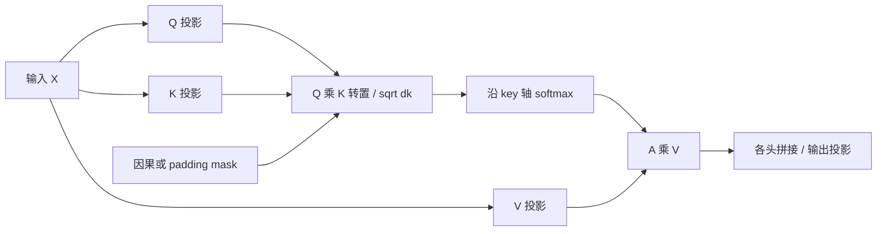
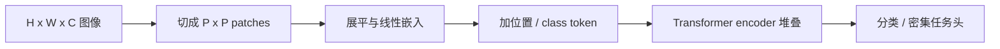
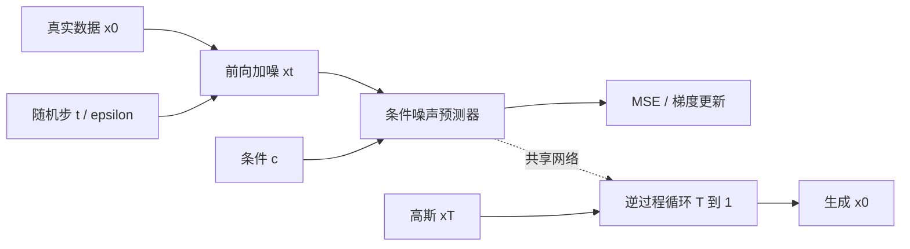

# 02 · 深度学习与 Transformer、扩散、流匹配

> 阅读目标：从损失与链式法则走到完整 Transformer；理解 DDPM 后验和噪声预测为何联系起来，以及流匹配学习的速度场。

## 1. 统一符号与学习目标

|符号|含义|形状 / 约定|
|---|---|---|
|$X,n,d,h$|token 特征、长度、隐藏宽度、头数|$X\in\mathbb R^{n\times d}$；每行一个 token|
|$Q,K,V,d_k,d_v$|query、key、value、头维数|单头分别为 $n_q\times d_k,n_k\times d_k,n_k\times d_v$|
|$W_Q,W_K,W_V,W_O$|投影参数|单头前三者 $d\times d_k,d\times d_k,d\times d_v$|
|$M,S,A$|mask、打分、注意力权重|$n_q\times n_k$；softmax 沿 key 轴|
|$\theta,\eta,\lambda$|参数、学习率、正则权重|$\eta>0$|
|$x_0,x_t,T,\beta_t$|数据、带噪样本、扩散总步数、噪声量|本章 DDPM 的 t 为整数|
|$\alpha_t,\bar\alpha_t,\epsilon$|保真率、累计保真率、高斯噪声|$\alpha_t=1-\beta_t,\bar\alpha_t=\prod_{s\le t}\alpha_s$|
|$v_\theta,u,t$|学到的速度、目标速度、流时间|流匹配 t 连续，$t\in[0,1]$|

$$\mathcal L(\theta)=\frac1N\sum_{i=1}^N\ell(f_\theta(x_i),y_i)+\lambda\Omega(\theta),\quad\theta\leftarrow\theta-\eta\nabla_\theta\mathcal L.\tag{2.1}$$

训练、验证、测试分别用于参数更新、超参选择、泛化评估；视频应按轨迹或场景切分。损失小并不自动保证闭环机器人成功。

## 2. 反向传播：从 softmax 到线性层

推导 1 · 交叉熵梯度与逐层链式法则

令 $p_k=e^{z_k}/\sum_j e^{z_j}$，标签 $y$ 满足 $\sum_k y_k=1$。交叉熵可展开为：

$$\begin{aligned}
\ell&=-\sum_k y_k\log p_k=-\sum_k y_kz_k+\log\sum_j e^{z_j},\\
\frac{\partial\ell}{\partial z_k}&=p_k-y_k.
\end{aligned}\tag{2.2}$$

对列向量线性层 $z=Wa+b$，令 $\delta=\partial\ell/\partial z$，则：

$$\frac{\partial\ell}{\partial W}=\delta a^\top,\quad\frac{\partial\ell}{\partial b}=\delta,\quad\frac{\partial\ell}{\partial a}=W^\top\delta.\tag{2.3}$$

非线性层 $a=\sigma(z)$ 再逐元素乘 $\sigma'(z)$。前向保存激活，反向复用；mini-batch 梯度按损失 reduction 汇总。softmax 实现先减最大 logit，避免溢出。

Adam 用梯度一阶和平方梯度二阶指数均值：

$$\begin{aligned}
m_t&=\beta_1m_{t-1}+(1-\beta_1)g_t,&v_t&=\beta_2v_{t-1}+(1-\beta_2)g_t^2,\\
\hat m_t&=m_t/(1-\beta_1^t),&\hat v_t&=v_t/(1-\beta_2^t),\\
\theta_t&=\theta_{t-1}-\eta\hat m_t/(\sqrt{\hat v_t}+\varepsilon).
\end{aligned}\tag{2.4}$$

平方和开方逐元素进行；优化器 epsilon 与扩散噪声 epsilon 是不同对象。AdamW 的解耦权重衰减也不同于把 L2 正则直接塞进 Adam 梯度。

## 3. 经典 Transformer：完整编码器—解码器

<figure class="diagram"><figcaption>图 2.1 · 按 Vaswani 等人的经典 Post-LN 架构重绘。图中蓝线为特征主流，虚线为残差；编码器输出为交叉注意力提供 K、V，解码器状态提供 Q。每个框架重复 N 层。</figcaption></figure>

原始模型使用编码器和解码器各 6 层；图中用一般 N 表示层数。训练时右移目标序列提供 teacher forcing，预测目标位置只能看到更早目标；推理时逐 token 生成。

推导 2 · 单头注意力、缩放、多头和梯度含义

$$\begin{aligned}
Q&=XW_Q,\quad K=XW_K,\quad V=XW_V,\\
S&=QK^\top/\sqrt{d_k}+M,\\
A_{ij}&=\frac{e^{S_{ij}}}{\sum_{r=1}^{n_k}e^{S_{ir}}},\qquad O=AV,\qquad o_i=\sum_j A_{ij}v_j.
\end{aligned}\tag{2.5}$$

自注意力三种投影来自同一序列；交叉注意力 Q 来自解码器，K、V 来自编码器，不要求两个序列等长。每行权重和为 1；输出宽度由 V 决定。

在独立零均值、单位方差分量的近似假设下：

$$\operatorname{Var}(q^\top k)=\sum_{r=1}^{d_k}\operatorname{Var}(q_rk_r)=d_k,\qquad\operatorname{Var}\left(\frac{q^\top k}{\sqrt{d_k}}\right)=1.\tag{2.6}$$

缩放抑制大维度下 softmax 过早饱和；真实训练表征不一定满足独立假设。其雅可比 $\partial A_j/\partial S_r=A_j(\delta_{jr}-A_r)$ 解释了权重接近 0/1 时梯度会变小。

$$\operatorname{MHA}(X)=\operatorname{Concat}(O_1,\ldots,O_h)W_O,\quad W_O\in\mathbb R^{hd_v\times d}.\tag{2.7}$$

多头是独立投影后的并行注意力，各头可以学习不同关系；它们不等同于预先指定“语法头”或“空间头”。标准设置 $d_k=d_v=d/h$。

推导 3 · 残差、层归一化、FFN、位置与 mask

经典编码器一层为（省略 dropout）：

$$U=\operatorname{LN}(X+\operatorname{MHA}(X)),\quad Y=\operatorname{LN}(U+\operatorname{FFN}(U)).\tag{2.8}$$

$$\operatorname{FFN}(u)=\operatorname{ReLU}(uW_1+b_1)W_2+b_2,\quad W_1\in\mathbb R^{d\times d_{ff}},\ W_2\in\mathbb R^{d_{ff}\times d}.\tag{2.9}$$

FFN 共享权重、逐位置变换；跨 token 交互在注意力里。对一个 token 的 d 个特征：

$$\operatorname{LN}(u)=\gamma\odot\frac{u-\mu(u)}{\sqrt{\sigma^2(u)+\varepsilon}}+\beta.\tag{2.10}$$

LayerNorm 不沿 batch 轴归一化。Pre-LN 则写 $X+F(\operatorname{LN}(X))$，与图中 Post-LN 顺序不同。残差路径的局部导数含 I，让梯度有直接通路。

$$\operatorname{PE}(p,2i)=\sin\left(p/10000^{2i/d}\right),\quad\operatorname{PE}(p,2i+1)=\cos\left(p/10000^{2i/d}\right).\tag{2.11}$$

这是经典正弦编码；学习式位置嵌入和 RoPE 是不同实现。因果 mask 使用 $M_{ij}=0$（$j\le i$）或 $-\infty$（$j>i$）；padding mask 再屏蔽填充位置。不要把所有 keys 都 mask 掉，否则 softmax 可能产生 NaN。

原始注意力计算 $O(n^2d)$，显式权重存储 $O(hn^2)$。KV cache 缓存过去 K/V，增量解码仍要读取过去上下文，不能称为与长度无关。

## 4. ViT：图片如何变成序列

$$n=HW/P^2,\qquad x_i=\operatorname{Flatten}(\text{patch}_i)W_E+e_i,\quad W_E\in\mathbb R^{P^2C\times d}.\tag{2.12}$$

要求图像尺寸可整除 patch 边长或显式 padding。加 class token 后序列长 n+1；分类头读 class token 或池化输出，检测/分割则需任务解码器。

## 5. DDPM：从递推加噪到逆过程

$$q(x_t|x_{t-1})=\mathcal N(\sqrt{\alpha_t}x_{t-1},\beta_t I),\quad x_t=\sqrt{\bar\alpha_t}x_0+\sqrt{1-\bar\alpha_t}\epsilon.\tag{2.13}$$

推导 4 · 合并高斯、后验配方和噪声预测目标

递推的均值系数连乘。若前一时刻条件方差为 $1-\bar\alpha_{t-1}$，新方差为：

$$\alpha_t(1-\bar\alpha_{t-1})+\beta_t=1-\bar\alpha_t.\tag{2.14}$$

贝叶斯把 $q(x_t|x_{t-1})q(x_{t-1}|x_0)$ 两个高斯相乘。对于未知 $x_{t-1}$ 配平方，精度相加：

$$\tilde\beta_t^{-1}=\frac{\alpha_t}{\beta_t}+\frac1{1-\bar\alpha_{t-1}},\qquad\tilde\beta_t=\frac{1-\bar\alpha_{t-1}}{1-\bar\alpha_t}\beta_t.\tag{2.15}$$

$$q(x_{t-1}|x_t,x_0)=\mathcal N(\tilde\mu_t,\tilde\beta_t I),\quad\tilde\mu_t=\frac{\sqrt{\bar\alpha_{t-1}}\beta_t}{1-\bar\alpha_t}x_0+\frac{\sqrt{\alpha_t}(1-\bar\alpha_{t-1})}{1-\bar\alpha_t}x_t.\tag{2.16}$$

由加噪式反解 $x_0=(x_t-\sqrt{1-\bar\alpha_t}\epsilon)/\sqrt{\bar\alpha_t}$，代入后验均值；以预测噪声替代真实噪声：

$$\mu_\theta(x_t,t,c)=\frac1{\sqrt{\alpha_t}}\left(x_t-\frac{\beta_t}{\sqrt{1-\bar\alpha_t}}\epsilon_\theta(x_t,t,c)\right).\tag{2.17}$$

对于固定逆过程方差 $\sigma_t^2I$，变分界中的高斯 KL 均值部分为加权 MSE：

$$L_t=\frac{\beta_t^2}{2\sigma_t^2\alpha_t(1-\bar\alpha_t)}\mathbb E\|\epsilon-\epsilon_\theta(x_t,t,c)\|^2+\text{常数}.\tag{2.18}$$

常用简化训练目标移除时间权重，故不是逐项完全相同的 ELBO：

$$L_{\mathrm{simple}}=\mathbb E_{x_0,t,\epsilon}\|\epsilon-\epsilon_\theta(\sqrt{\bar\alpha_t}x_0+\sqrt{1-\bar\alpha_t}\epsilon,t,c)\|^2.\tag{2.19}$$

采样从 $x_T\sim\mathcal N(0,I)$ 开始，递减 t，取 $x_{t-1}=\mu_\theta+\sigma_t z$；最后一步通常不加噪声。$\bar\alpha_T$ 需足够小让终态近似先验。训练采一个随机 t，推理需多次网络调用。

## 6. Flow Matching：条件速度与边缘速度

源样本 $x_0\sim p_0$、数据 $x_1\sim p_1$，选择样本耦合后构造直线路径：

$$x_t=(1-t)x_0+tx_1,\quad u=x_1-x_0,\quad L_{\mathrm{CFM}}=\mathbb E\|v_\theta(x_t,t)-u\|^2.\tag{2.20}$$

推导 5 · 为什么回归端点差能学习分布的速度

同一 $(x,t)$ 可以对应不同端点。对条件平方误差求最优回归函数：

$$v^*(x,t)=\mathbb E[x_1-x_0\mid x_t=x],\qquad\partial_t p_t+\nabla\cdot(p_tv^*)=0.\tag{2.21}$$

条件均值给边缘分布的运输速度；在足够正则且准确拟合的条件下，积分 $dx/dt=v_\theta(x,t)$ 可以从源分布运输到数据分布。Euler 离散：

$$x_{k+1}=x_k+\Delta t\,v_\theta(x_k,t_k),\quad t_k=k/K.\tag{2.22}$$

端点配对、路径、数值求解器和步数都会影响结果；少步数会引入积分误差。Flow Matching 是训练速度场的框架，不能简单等同“扩散减少步数”。本节的 0 表示噪声源，而 DDPM 的 0 表示数据，请特别留意。

## 7. 方法比较与实现检查

|模型|学习对象|典型推理|主要限制|
|---|---|---|---|
|Transformer|上下文表征 / 条件 token 分布|编码一次或自回归解码|序列长、KV、mask|
|VAE|生成器与近似后验|采潜变量再解码|似然假设、后验塌缩|
|DDPM|噪声 / 逆过程均值|多步反向采样|时间、方差 / 调度选择|
|Flow Matching|时间条件速度场|ODE 数值积分|路径与耦合、离散误差|

来源：[Transformer §3](https://arxiv.org/html/1706.03762v7)、[ViT](https://arxiv.org/abs/2010.11929)、[DDPM §2–3](https://arxiv.org/html/2006.11239v2)、[Flow Matching](https://arxiv.org/abs/2210.02747)。推导和图为教学重写，省略的 dropout 等实现细节已明确指出。
