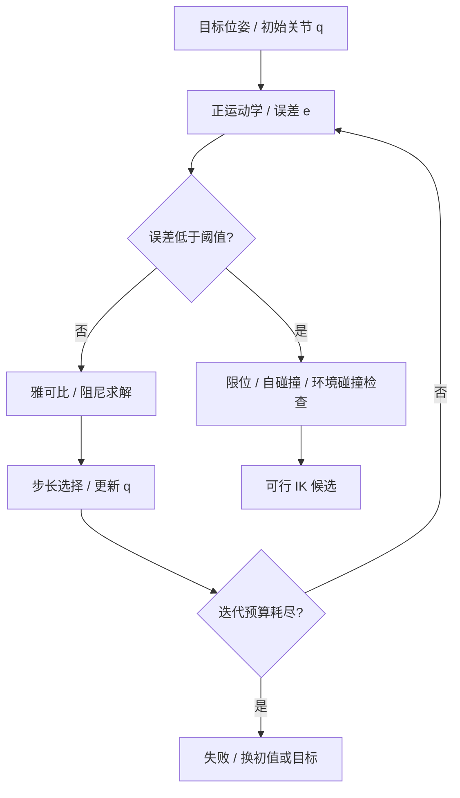
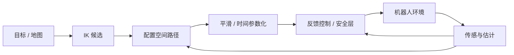

# 03 · 机器人运动学、动力学与控制

> 阅读目标：把末端几何目标变为关节轨迹与控制输入。区分路径、时间轨迹和实际闭环控制。

## 1. 符号与接口

|符号|含义|维数 / 单位|
|---|---|---|
|$q,\dot q,\ddot q$|关节位置、速度、加速度|n；旋转 rad、移动 m 及其时间导数|
|$p,R,T$|末端位置、旋转、齐次位姿|3、3×3、4×4|
|$\xi=[v;\omega],J$|线速度在前的几何 twist、雅可比|6、6×n；不与角速度在前约定混用|
|$M,C,g,\tau$|惯性矩阵、速度耦合、重力、广义力|力矩关节 N·m，移动关节 N|
|$x,u,A,B$|控制状态、输入、线性系统矩阵|状态/动作维度由模型指定|
|$Q,R_c,P,K$|状态代价、控制代价、价值矩阵、反馈增益|$R_c\succ0,Q\succeq0$；区别旋转 R|
|$e,\lambda,\eta$|任务误差、IK 阻尼、迭代步长|位置和朝向需权重 / 缩放|

## 2. 正运动学：变换连乘与二连杆例子

$$ {}^BT_E(q)=\prod_{i=1}^nT_{i-1,i}(q_i),\quad T_{i-1,i}=\operatorname{Rot}_z(\theta_i)\operatorname{Trans}_z(d_i)\operatorname{Trans}_x(a_i)\operatorname{Rot}_x(\alpha_i).\tag{3.1}$$

这是标准 DH 次序；改进 DH 的轴定义和顺序不同。旋转关节的 theta 可变，移动关节的 d 可变。工具偏置还需在末端右乘固定变换。

推导 1 · 平面二连杆的位置与雅可比

连杆长 $l_1,l_2$，关节角 $q_1,q_2$。第一连杆方向 $q_1$，第二连杆绝对方向 $q_1+q_2$：

$$\begin{aligned}p_x&=l_1\cos q_1+l_2\cos(q_1+q_2),\\p_y&=l_1\sin q_1+l_2\sin(q_1+q_2),\\J_p&=\begin{bmatrix}-l_1\sin q_1-l_2\sin(q_1+q_2)&-l_2\sin(q_1+q_2)\\l_1\cos q_1+l_2\cos(q_1+q_2)&l_2\cos(q_1+q_2)\end{bmatrix}.
\end{aligned}\tag{3.2}$$

直接对每个关节角求偏导即得雅可比；$\det J_p=l_1l_2\sin q_2$，伸直或折叠时位置控制奇异。$l_1=l_2=1$ m，$q=(0,\pi/2)$ 时 $p=(1,1)$ m，$J_p=[-1,-1;1,0]$。

一般三维旋转关节第 i 列为 $J_i=[z_i\times(p_E-p_i);z_i]$，移动关节为 $[z_i;0]$；所有轴、点必须在同一参考系表达。

## 3. 逆运动学：局部线性化到阻尼最小二乘

目标位姿 $T^*$，当前位姿 $T(q)$。局部误差选 $e=[p^*-p;\operatorname{Log}(R^*R^\top)^\vee]$，这里旋转误差和空间雅可比使用同一参考系。

推导 2 · 正则化 IK、奇异值解释和迭代流程

由 Taylor 展开，$e\approx J\Delta q$。求正则化最小二乘：

$$\min_{\Delta q}\ \|J\Delta q-e\|^2+\lambda^2\|\Delta q\|^2.\tag{3.3}$$

$$\begin{aligned}(J^\top J+\lambda^2I)\Delta q&=J^\top e,\\\Delta q&=J^\top(JJ^\top+\lambda^2I)^{-1}e,\\q_{k+1}&=q_k+\eta\Delta q.\end{aligned}\tag{3.4}$$

用 $J=U\operatorname{diag}(\sigma_i)V^\top$，阻尼逆的增益是 $\sigma_i/(\sigma_i^2+\lambda^2)$，而伪逆是 $1/\sigma_i$。因此小奇异值不会无限放大关节步长；代价是残差不能完全消除。

位置米和朝向弧度需任务权重 W，目标改为 $\|W^{1/2}(J\Delta q-e)\|^2$。大旋转时应使用与 Log 误差一致的雅可比修正，而非把几何雅可比无条件当成精确导数。

## 4. 动力学：Euler–Lagrange 方程

推导 3 · 能量到惯性、重力和单摆例子

动能 $\mathcal T=\tfrac12\dot q^\top M(q)\dot q$，势能 $V(q)$，$\mathscr L=\mathcal T-V$。

$$\frac d{dt}\frac{\partial\mathscr L}{\partial\dot q_i}-\frac{\partial\mathscr L}{\partial q_i}=\tau_i,\qquad M(q)\ddot q+C(q,\dot q)\dot q+g(q)=\tau+J^\top F_{ext}.\tag{3.5}$$

其中 $g_i=\partial V/\partial q_i$，一种标准 C 定义为：

$$C_{ij}=\sum_k\frac12\left(\frac{\partial M_{ij}}{\partial q_k}+\frac{\partial M_{ik}}{\partial q_j}-\frac{\partial M_{jk}}{\partial q_i}\right)\dot q_k.\tag{3.6}$$

单摆：质点 m、杆长 l、q 从竖直向下测量，$\mathcal T=ml^2\dot q^2/2$，$V=mgl(1-\cos q)$，所以 $ml^2\ddot q+mgl\sin q=\tau$。如有粘性摩擦还加 $b\dot q$。

外力通过虚功：$\delta W=F^\top\delta x=F^\top J\delta q$，故关节广义力为 $J^\top F$；wrench 的力 / 力矩排列须与 twist 对偶。真实系统还包含驱动器时延、齿隙与接触。

## 5. PID、LQR 与 MPC

PID 的输入可为驱动器的速度或力矩指令，依接口决定：

$$u(t)=K_pe(t)+K_i\int_0^t e(s)ds+K_d\dot e(t).\tag{3.7}$$

积分项抗稳态扰动但需抗饱和；微分项会放大测量噪声，通常滤波并对测量微分。反馈频率和通信延迟决定稳定裕度。

推导 4 · Bellman 二次价值到离散 Riccati 方程

线性系统 $x_{k+1}=Ax_k+Bu_k$；无限时域代价 $\sum_{k\ge0}(x_k^\top Qx_k+u_k^\top R_cu_k)$，假定稳定化 / 可检测条件。设 $V(x)=x^\top Px$：

$$V(x)=\min_u\left[x^\top Qx+u^\top R_cu+(Ax+Bu)^\top P(Ax+Bu)\right].\tag{3.8}$$

对 u 求导得 $(R_c+B^\top PB)u=-B^\top PAx$。因此：

$$K=(R_c+B^\top PB)^{-1}B^\top PA,\quad u=-Kx,\quad P=Q+A^\top PA-A^\top PB(R_c+B^\top PB)^{-1}B^\top PA.\tag{3.9}$$

MPC 则在每个时刻解有限时域优化：

$$\begin{aligned}\min_{u_{0:H-1}}\ &\sum_{k=0}^{H-1}\ell(x_k,u_k)+V_f(x_H)\\\text{s.t. }&x_{k+1}=f(x_k,u_k),\quad x_k\in\mathcal X,\ u_k\in\mathcal U.\end{aligned}\tag{3.10}$$

仅执行第一个控制量，再估状态并重解。约束可以表达关节、碰撞、力矩限制；实时优化失败要有明确降级接口。

## 6. 路径、轨迹与规划算法

路径 $q(s)$ 描述几何；轨迹 $q(s(t))$ 加时间。链式法则约束速度与加速度：

$$\dot q=q'(s)\dot s,\qquad\ddot q=q''(s)\dot s^2+q'(s)\ddot s.\tag{3.11}$$

|算法|关键步骤|保证的条件 / 限制|
|---|---|---|
|A*|弹出最小 $g+h$，扩展邻居、更新父节点|一致启发式或正确重开节点；有限图等标准条件|
|RRT|采样、最近邻、向样本扩展、碰撞检查|概率完备须满足假设；不保证最优|
|RRT*|RRT 后选择低成本父节点并重连邻域|适当邻域和采样条件下渐近最优|
|轨迹优化|以初轨迹最小化平滑 / 碰撞 / 动力学代价|局部极值；需可行性复核|

抓取应用：标定 → 世界系点云 → 抓取候选 → IK / 碰撞过滤 → 接近轨迹 → 闭环修正 → 接触 / 提起验证。工具和夹具也参与碰撞检测，不能只检查末端点。

来源：[Modern Robotics 教材与配套材料](https://modernrobotics.northwestern.edu/)、[RRT / 规划教材](https://lavalle.pl/planning/)。本章为教学推导，不绑定具体机器人接口。
