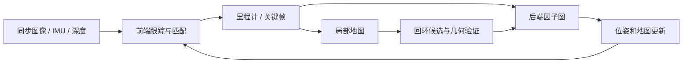
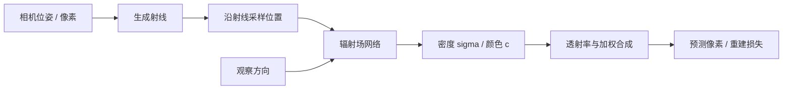

# 04 · 视觉、SLAM 与三维表示

> 阅读目标：理解像素怎样变成几何地图，地图怎样估计与融合，以及可渲染场景为何还需几何验证才能用于行动。

## 1. 符号与相机模型

|符号|含义|单位 / 条件|
|---|---|---|
|$K,R_{CW},t_{CW}$|相机内参、世界到相机外参|K 像素；t 米|
|$P_C,P_W,u,v,Z$|三维点、像素、光轴深度|米、pixel、米|
|$f,B,d$|校正双目焦距、基线、视差|pixel、米、pixel|
|$R,t,H$|配准旋转、平移、互协方差|R 正交，det=1|
|$X_i,Z_{ij},\Omega_{ij}$|位姿、相对位姿测量、信息矩阵|SE(3)、SE(3)、6×6|
|$\sigma,c,T,\alpha$|体密度、颜色、透射率、不透明度|逆长度、RGB、无量纲|
|$\mu_i,\Sigma_i,\alpha_i$|3D 高斯中心、协方差、不透明度|3、3×3、标量|

$$Z\begin{bmatrix}u\\v\\1\end{bmatrix}=K(R_{CW}P_W+t_{CW}),\quad P_W=R_{CW}^\top\left(ZK^{-1}\begin{bmatrix}u\\v\\1\end{bmatrix}-t_{CW}\right).\tag{4.1}$$

时间同步与畸变校正先于反投影。传感器缺测区域保留 unknown；世界坐标需要正确尺度与外参。

## 2. 双目深度与不确定性

推导 1 · 左右投影相减与深度噪声

校正后光轴平行，主点已对齐。左相机原点坐标 X，右相机横坐标 X−B：

$$u_L-c_x=fX/Z,\quad u_R-c_x=f(X-B)/Z,\quad d=u_L-u_R=fB/Z.\tag{4.2}$$

$$Z=fB/d,\quad\frac{\partial Z}{\partial d}=-fB/d^2,\quad\sigma_Z^2\approx(fB/d^2)^2\sigma_d^2.\tag{4.3}$$

焦距和基线也有误差时用联合雅可比传播，不能只计算视差误差。无纹理、反光、透明、遮挡和重复纹理是典型失败来源。

## 3. ICP：对应匹配与 SVD 刚体解

点云先下采样、去离群点、估计法向；初始化可使用特征匹配 / RANSAC。ICP 在固定对应和重估对应之间交替。

推导 2 · 中心化、迹最大化、反射修正

$$\min_{R\in SO(3),t}\sum_i\|Rx_i+t-y_i\|^2.\tag{4.4}$$

对 t 求导得 $t=\bar y-R\bar x$。令 $\tilde x_i=x_i-\bar x$、$\tilde y_i=y_i-\bar y$，旋转不改范数，展开目标：

$$\sum_i\|R\tilde x_i-\tilde y_i\|^2=\text{常数}-2\operatorname{tr}(RH),\quad H=\sum_i\tilde x_i\tilde y_i^\top.\tag{4.5}$$

$$H=U\Lambda V^\top,\quad R^*=V\operatorname{diag}(1,1,\det(VU^\top))U^\top,\quad t^*=\bar y-R^*\bar x.\tag{4.6}$$

对角修正保证 det=+1，排除镜像。最近邻对应并非真实同一点，所以最终解可能局部错误；平面、对称物体和小重叠有退化。点到面 ICP 用残差 $n_i^\top(Rx_i+t-y_i)$，通常通过局部线性化求解。

## 4. SLAM：因子图与 Gauss–Newton

推导 3 · 概率假设、规范自由度和稀疏求解

独立高斯测量误差下，最大后验可写加权平方和：

$$\min_{\{X_i\}}\sum_{(i,j)}r_{ij}^\top\Omega_{ij}r_{ij},\quad r_{ij}=\operatorname{Log}(Z_{ij}^{-1}X_i^{-1}X_j)^\vee.\tag{4.7}$$

信息矩阵的坐标表达要与残差切空间一致。局部扰动 $\delta$ 下，$r(\delta)\approx r+J\delta$，对平方目标求导：

$$\left(\sum J^\top\Omega J\right)\delta=-\sum J^\top\Omega r,\quad X_i\leftarrow X_i\operatorname{Exp}(\widehat{\delta_i}).\tag{4.8}$$

这里采用右扰动，实际 J 必须按同一约定推导。固定首个位姿或加先验消除全局刚体规范自由度；纯单目还存在尺度歧义。回环错误会破坏全图，需几何验证、鲁棒核和异常检测。VIO 还引入速度、偏置和 IMU 预积分因子。

## 5. 地图表示与 TSDF 融合

|表示|存什么|优势|限制 / 行动接口|
|---|---|---|---|
|点云|XYZ、颜色、法向、标签|直接测量 / 配准|无拓扑、稀疏和遮挡|
|占据栅格|空 / 占据 / 未知概率|导航碰撞查询|内存随三维分辨率增长|
|TSDF|截断有符号表面距离与权重|多帧融合 / 网格|薄结构与动态对象|
|网格|顶点和三角面|仿真 / 渲染 / 碰撞|重建拓扑和闭合性|
|NeRF|连续密度 / 颜色函数|新视角合成|需额外几何提取与验证|
|3DGS|显式高斯 / 颜色 / 不透明度|高效渲染|不自动提供物理表面|
|场景图|对象及关系|语言目标与任务规划|依赖定位 / 关系可靠度|

深度 z 与沿投影射线的体素深度 z_v 产生截断距离 $D_{obs}=\operatorname{clip}((z-z_v)/\mu,-1,1)$；这里只定义投影 TSDF 的一类实现，正号表示表面前方。加权融合：

$$D_{new}=\frac{w_{old}D_{old}+w_{obs}D_{obs}}{w_{old}+w_{obs}},\quad w_{new}=w_{old}+w_{obs}.\tag{4.9}$$

实际实现会截断累计权重并跳过遮挡 / 无效区域；运动物体不能直接融合进静态地图。

## 6. NeRF：连续透射到离散体渲染

推导 4 · Beer–Lambert 衰减、射线积分、离散权重

射线 $r(t)=o+td$，d 为单位方向。介质透射率满足 $dT/dt=-\sigma(r(t))T$，所以：

$$T(t)=\exp\left(-\int_{t_n}^t\sigma(r(s))ds\right),\quad C=\int_{t_n}^{t_f}T(t)\sigma(r(t))c(r(t),d)dt+T(t_f)c_{bg}.\tag{4.10}$$

每段假设密度和颜色恒定，段长 $\delta_i$：

$$\alpha_i=1-e^{-\sigma_i\delta_i},\quad T_i=\prod_{j<i}(1-\alpha_j),\quad\hat C=\sum_i T_i\alpha_i c_i+T_{end}c_{bg}.\tag{4.11}$$

原稿把指数项称作“不透射概率”容易误读，这里明确：$e^{-\sigma_i\delta_i}$ 是透射比例，$1-e^{-\sigma_i\delta_i}$ 是终止 / 不透明权重。训练用多视角颜色误差，对场函数参数反传。

## 7. 3D Gaussian Splatting：投影与合成

$$G_i(x)=\exp\left[-\tfrac12(x-\mu_i)^\top\Sigma_i^{-1}(x-\mu_i)\right],\quad\Sigma_i=R_i\operatorname{diag}(s_i^2)R_i^\top.\tag{4.12}$$

推导 5 · 三维高斯投影近似与前后合成

把中心投到相机平面。在中心附近线性化投影函数，世界到相机旋转为 $R_{CW}$、投影雅可比为 $J_\pi$：

$$\Sigma_{2D}\approx J_\pi R_{CW}\Sigma_iR_{CW}^\top J_\pi^\top.\tag{4.13}$$

按深度排序的二维 footprint alpha 为 $\tilde\alpha_i=\alpha_iG_i^{2D}(u)$，像素颜色：

$$C(u)=\sum_i c_i\tilde\alpha_i\prod_{j<i}(1-\tilde\alpha_j).\tag{4.14}$$

三维协方差分解保证正定；颜色可由球谐函数表达视角依赖。原方法还包含自适应增密、裁剪等，图示和式子只描述核心渲染路径。高斯外观不直接等同真实碰撞体积，机器人应额外维护占据 / TSDF / 网格及不确定性。

来源：[NeRF 作者项目](https://www.matthewtancik.com/nerf)、[3DGS 原论文](https://arxiv.org/abs/2308.04079)、[GTSAM 因子图入门](https://gtsam.org/tutorials/intro.html)。
