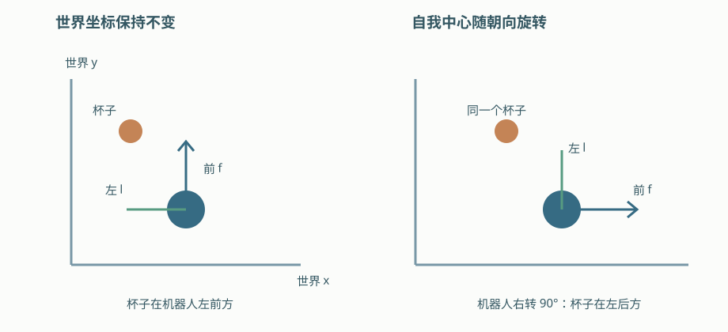
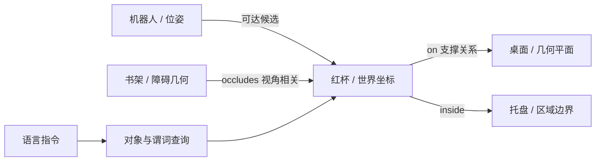
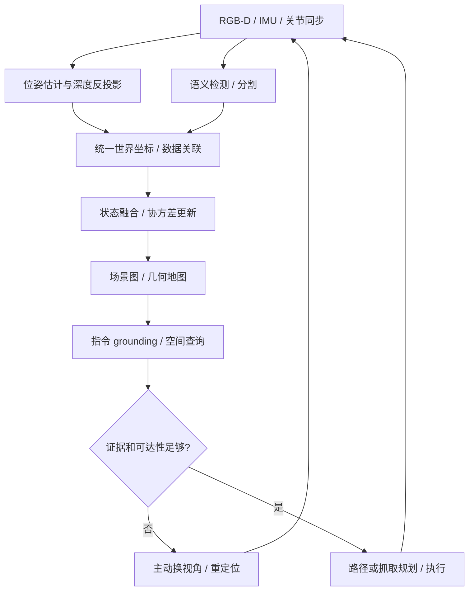

# 05 · 空间智能：几何、关系、信念与世界模型

> 本章使用工作定义：空间智能是感知、维护、推理和预测空间状态，并利用它指导行动的能力集合。不同研究的定义与评测边界不统一，以下按可检验能力组织。

## 1. 能力层次与符号

|层次|输入 → 输出|验证方式|
|---|---|---|
|感知|图像 / 点云 → 深度、物体、朝向|测量误差 / 定位误差|
|表征|多帧观测 → 地图、ID、对象关系|跨视角一致性 / 漂移|
|推理|状态与问题 → 关系、距离、可达性|几何证据 / 标注答案|
|预测|状态与动作 → 后续状态|多步误差 / 动作后果|
|行动|目标与空间状态 → 导航 / 操作|任务成功 / 碰撞 / 恢复|

|符号|含义|约定|
|---|---|---|
|$p_i^W,\Sigma_i$|对象 i 的世界位置与协方差|米、米平方|
|$f,l,n$|前向、左向、上向单位基|右手系，$l=n\times f$|
|$G=(V,E),r_{ij}$|场景图与关系属性|边携带参考系和时间|
|$s_t,o_t,a_t,b_t$|真实状态、观测、动作、状态信念|$b_t=P(s_t\mid o_{\le t},a_{<t})$|
|$F,H,Q,R$|状态转移、观测映射、过程 / 测量噪声协方差|卡尔曼模型局部定义|
|$z_t,f_\theta,H_p$|潜状态、世界转移模型、规划窗口|H_p 与观测矩阵 H 区分|

## 2. 自我中心与环境中心：关系有参考系

自我中心以相机或机器人当前方向定义前后左右；环境中心以固定地图轴表达。机器人转身后，前者会变化。令 A 为参考物、B 为查询物，$\Delta p=p_B-p_A$。

$$d=\|\Delta p\|_2,\quad s_{front}=f^\top\Delta p,\quad s_{left}=l^\top\Delta p,\quad s_{up}=n^\top\Delta p.\tag{5.1}$$

约定 $s_{left}>\tau$ 表示 B 在 A 左侧。阈值避免把几乎同线的点强行二分类。“inside”和“on”还需要几何范围、接触 / 支撑证据，不能仅比较中心高低。

推导 1 · 带不确定性的关系概率

若位置差近似高斯，且参考轴 l 确定：

$$\begin{aligned}\Delta p&\sim\mathcal N(\mu_\Delta,\Sigma_\Delta),\\\Sigma_\Delta&=\Sigma_A+\Sigma_B-\Sigma_{AB}-\Sigma_{BA},\\s=l^\top\Delta p&\sim\mathcal N(l^\top\mu_\Delta,l^\top\Sigma_\Delta l),\\P(B\text{ 在 A 左侧})&=\Phi\left(\frac{l^\top\mu_\Delta-\tau}{\sqrt{l^\top\Sigma_\Delta l}}\right).
\end{aligned}\tag{5.2}$$

Phi 为标准正态累积分布函数；两对象独立时交叉协方差为零。若位姿参考轴也不确定，还需对 l 联合传播。共享定位误差会使对象相关，简单相加可能失真。

例如 $s$ 均值 0.1 m、标准差 0.02 m、阈值 0.05 m，概率约 0.994；若标准差增为 0.1 m，则约 0.691，应返回不确定程度而非同样自信。

<figure class="diagram"><figcaption>图 5.1 · 对象世界位置不变，机器人转身会改变 egocentric 关系。明确参考轴比只给 left-of 标签更可检验。</figcaption></figure>

## 3. 场景图：几何地图与语义状态相连

对象节点属性包括类别、实例 ID、位姿、尺寸、可供性、协方差、最后观测时间。边包括 inside、on、near、occludes、reachable-from，每条边保留证据与置信度。

可供性如“可抓取”依赖机器人、夹爪和姿态；不能视为物体永恒属性。场景图补充几何地图：图负责对象关系，碰撞检测仍查询占据 / 网格等几何。

## 4. 从多视角观测到状态信念

推导 2 · 贝叶斯滤波与卡尔曼更新

POMDP 的信念先预测再校正：

$$\bar b_t(s)=\int p(s|s',a_{t-1})b_{t-1}(s')ds',\quad b_t(s)=\frac{p(o_t|s)\bar b_t(s)}{\int p(o_t|u)\bar b_t(u)du}.\tag{5.3}$$

线性高斯特例 $s_t=Fs_{t-1}+Ba_{t-1}+w_t$、$o_t=Hs_t+v_t$，$w\sim\mathcal N(0,Q),v\sim\mathcal N(0,R)$：

$$\begin{aligned}\bar\mu_t&=F\mu_{t-1}+Ba_{t-1},&\bar\Sigma_t&=F\Sigma_{t-1}F^\top+Q,\\S_t&=H\bar\Sigma_tH^\top+R,&K_t&=\bar\Sigma_tH^\top S_t^{-1},\\\mu_t&=\bar\mu_t+K_t(o_t-H\bar\mu_t),\\\Sigma_t&=(I-K_tH)\bar\Sigma_t(I-K_tH)^\top+K_tRK_t^\top.
\end{aligned}\tag{5.4}$$

最后一式为 Joseph 形式，数值上更稳。K 表示预测与观测权衡：测量噪声越大，更新越依赖先验。非线性模型需 EKF / UKF / 粒子等；对象匹配错误是离散歧义，不能靠高斯滤波自动修复。

## 5. 语言空间推理：可复核的证据链

1. **Grounding**：定位“蓝盒”和“红杯”的具体实例，保留 mask / 3D 候选。
2. **Geometry**：提取位置、尺寸、深度及不确定性，检查单位与时间。
3. **Reference**：确认以相机、机器人还是世界方向解释“左”。
4. **Predicate**：调用关系概率、距离、射线遮挡、碰撞 / 可达查询。
5. **Answer / Action**：给出答案、依据、置信度；证据弱时主动观察。

把数字坐标拼进提示不保证语言模型掌握度量；几何工具输出可验证数值结果，再由模型组织任务和解释。

## 6. 世界模型与滚动规划

模型可预测真实状态或潜状态：$z_{t+1}=f_\theta(z_t,a_t)$，观测器 $\hat o_t=g_\theta(z_t)$。视觉生成合理并不证明动力学正确。

推导 3 · 误差累积、MPC 和主动观测

若单步模型误差至多 epsilon、转移对状态 Lipschitz 常数 L，同动作下：

$$e_{k+1}\le Le_k+\epsilon,\quad e_H\le L^He_0+\epsilon\sum_{j=0}^{H-1}L^j.\tag{5.5}$$

这是上界解释：L 大于 1 时误差可能迅速增长，并非所有系统必然如此。闭环重新估状态能缩短未校正 rollout。

$$A^*=\arg\min_{a_{0:H_p-1}}\sum_{k=0}^{H_p-1}c(\hat s_k,a_k)+c_T(\hat s_{H_p}),\quad\hat s_{k+1}=f_\theta(\hat s_k,a_k).\tag{5.6}$$

可增加不确定性惩罚与约束。主动观测选择预期降低信念熵的视角：

$$a_{view}^*=\arg\max_a\left[\mathcal H(b_t)-\mathbb E_{o\mid a}\mathcal H(b_{t+1})-\lambda\,\operatorname{cost}(a)\right].\tag{5.7}$$

这是规划原则，不是某个世界模型论文的通用训练损失。视角收益需与移动成本、碰撞和时间一起考虑。

## 7. 应用与研究索引

桌面抓取需要对象定位、接近可达性、支撑关系和接触验证；室内导航结合语义目标、占据地图、动态障碍和定位；AR / 数字孪生侧重重建与对齐，物理模拟还需质量、接触和可碰撞几何。

|路线|代表检索入口|本库覆盖|
|---|---|---|
|三维感知|PointNet、NeRF、3DGS、深度估计|几何与表示基础|
|空间语言|SpatialVLM、SpatialRGPT、3D-LLM、LEO|grounding 与证据链|
|世界模型|World Models、视频 / 动作条件生成|状态预测与规划原则|
|基准|BLINK、ScanQA、SQA3D、VSI-Bench、Habitat|评测维度与指标|

上述为旧飞书稿的研究路线索引，未逐篇核验版本、性能与完整实现。详细论文归档应逐项扩充，不能把索引条目视为已讲解模型。

已展开的专题：三维感知、开放词汇 3D 与空间问答见 [14 · 三维基础模型与空间推理](14_三维基础模型与空间推理.md)；导航、主动探索与 VLN 见 [13 · 导航与视觉语言导航](13_导航与视觉语言导航.md)；世界模型与想象中规划见 [15 · 世界模型](15_世界模型.md)。配套视频“空间参考系”“贝叶斯滤波”见 [18 · 视频讲解](18_视频讲解.md)。

来源：[World Models](https://arxiv.org/abs/1803.10122)、[Habitat 项目](https://aihabitat.org/)、[SLAM 因子图](https://gtsam.org/tutorials/intro.html)；关系概率和误差界是本讲义的教学推导。
