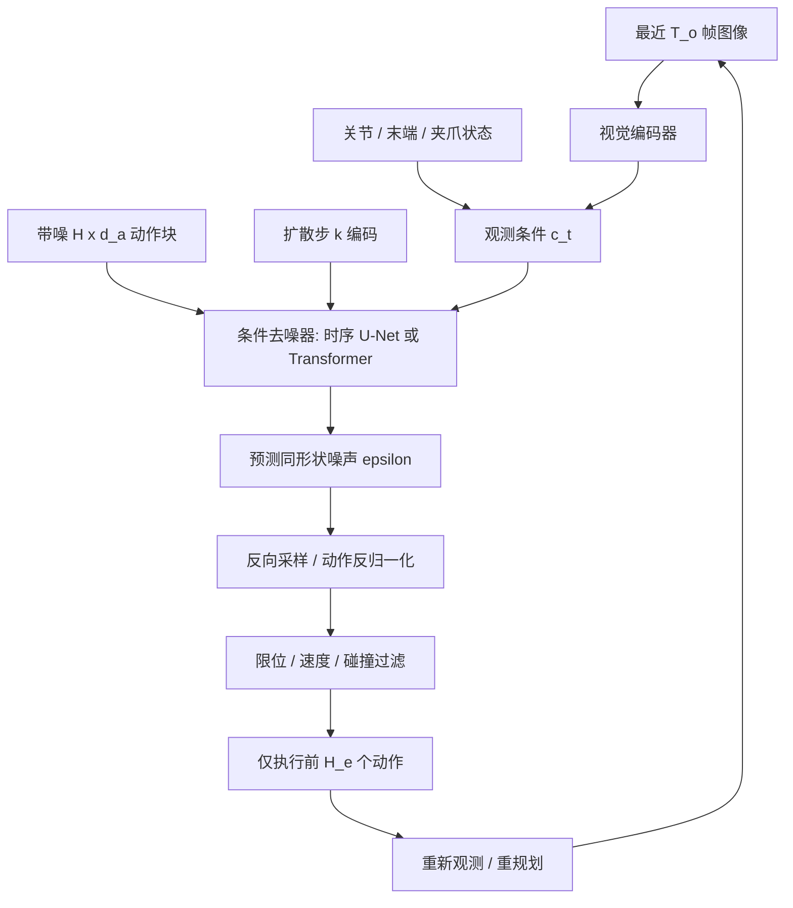
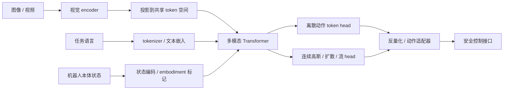

# 06 · 具身学习、Diffusion Policy 与 VLA

> 阅读目标：理解行为克隆的分布偏移、动作扩散的训练 / 部署差别，建立 VLA 与底层控制之间明确的接口。

## 1. 符号与决策问题

|符号|含义|维数 / 约定|
|---|---|---|
|$s_t,o_t,a_t,r_t$|状态、观测、动作、奖励|t 为环境时间|
|$\pi_\theta,\gamma,D$|策略、折扣、演示数据|$0\le\gamma<1$|
|$A^0,A^k$|干净 / 带噪动作块|$H\times d_a$；上标 k 为扩散时间|
|$T_o,H,H_e,K_d$|观测窗口、预测动作数、执行动作数、去噪步数|$1\le H_e\le H$，避免都写成 K|
|$c_t,\epsilon_\theta,\bar\alpha_k$|观测条件、去噪网络、累计调度|条件可含图像、本体、语言|
|$\mu,\Sigma$|动作高斯均值、协方差|动作单位 / 单位平方|

闭环：观测 → 状态 / 特征 → 策略动作 → 安全过滤 → 控制执行 → 新观测。图像控制策略输出的目标通常由更高频控制器跟踪。

## 2. 行为克隆与强化学习

$$L_{BC}=-\mathbb E_{(o,a)\sim D}\log\pi_\theta(a|o),\qquad J_{RL}=\mathbb E_\pi\sum_{t\ge0}\gamma^t r_t.\tag{6.1}$$

<details class="derivation" open><summary>推导 1 · 高斯动作的 NLL、多模态与分布偏移</summary>

若 $\pi=\mathcal N(\mu_\theta(o),\Sigma_\theta(o))$，动作维数 d_a：

$$-\log\pi(a|o)=\frac12(a-\mu)^\top\Sigma^{-1}(a-\mu)+\frac12\log|\Sigma|+\frac{d_a}{2}\log(2\pi).\tag{6.2}$$

固定各向同性方差时，优化均值相当于 MSE。左右绕障是双峰，单均值可能穿过障碍；需要混合分布、离散序列或扩散等多模态表达。

专家数据来自 $d_E(s)$，部署访问 $d_\pi(s)$；偏离后可能进入训练没覆盖的状态。有限时域下，每步错误概率 epsilon、最坏错误一旦发生影响剩余所有步骤：

$$\sum_{t=1}^T O(t\epsilon)=O(T^2\epsilon).\tag{6.3}$$

这是常见最坏情况解释，不是每个机器人都会出现的实测误差律。DAgger 在学习策略访问的状态请求专家纠正并聚合数据，缓解分布偏移；还可做扰动数据和恢复行为采集。

对于 RL，贝尔曼关系 $Q^\pi(s,a)=\mathbb E[r+\gamma\mathbb E_{a'\sim\pi}Q^\pi(s',a')]$ 明确优化长期回报，不同于逐帧模仿。稀疏奖励、探索与实机采样成本常促使从演示初始化。

</details>

## 3. Diffusion Policy 架构与条件动作去噪



图为代表性的条件动作扩散结构；原论文探索了不同骨干与条件方式，不能把某一种注入结构当作全部 DP 的唯一架构。

<details class="derivation" open><summary>推导 2 · 训练目标、逆采样和动作窗口</summary>

将 H 个动作看作一个高维样本，沿用 DDPM 前向闭式：

$$A^k=\sqrt{\bar\alpha_k}A^0+\sqrt{1-\bar\alpha_k}\epsilon,\quad L_{DP}=\mathbb E\|\epsilon-\epsilon_\theta(A^k,k,c_t)\|_F^2.\tag{6.4}$$

范数为全部动作元素平方和；实现可取均值，但权重 / 学习率要与 reduction 对齐。DDPM 型采样为：

$$A^{k-1}=\frac1{\sqrt{\alpha_k}}\left(A^k-\frac{\beta_k}{\sqrt{1-\bar\alpha_k}}\epsilon_\theta(A^k,k,c_t)\right)+\sigma_k z,\quad z\sim\mathcal N(0,I).\tag{6.5}$$

DDIM 等采样器有不同更新式；不能换 scheduler 却仍使用上式。原始动作先归一化，采样后恢复物理单位；绝对位姿、位姿增量、关节目标、速度与力矩语义各不相同。

训练批处理与在线控制的伪代码：

```text
TRAIN: sample (observation history, future action block) from one trajectory
       encode condition; sample diffusion k and Gaussian epsilon
       construct noisy actions; predict epsilon; compute loss; update parameters
DEPLOY: synchronize latest observations; encode condition
        initialize Gaussian action block; denoise K_d times
        undo normalization; verify action units and constraints
        execute first H_e actions; measure new state; repeat until termination
```

数据窗口不可跨轨迹边界；终止后的 padding 需 mask。推理动作的起始索引应考虑观测历史对齐和推理期间机器人已执行动作，避免把过期动作当未来目标。

</details>

## 4. 控制预算：预测长度与执行长度

控制周期 delta、推理延迟 L，若每次执行 H_e 步，保持连续控制通常要求：

$$L+L_{pre}+L_{comm}\lesssim H_e\,\Delta t.\tag{6.6}$$

这只是调度预算，异步 pipeline 和缓存可能改变边界。H_e 大节省模型调用但反馈稀疏；H 大提供长期协调但预测更难；去噪步数 K_d 大增加采样成本。实机需报告 p50 / p95 延迟、动作时间戳、排队、丢帧、控制器频率。

## 5. VLA：视觉、语言、本体到动作



动作头两支为替代设计，不要求同一个模型同时采用。RT-2 属于将动作表达为 token 并结合视觉语言知识的具体方法；现代 VLA 也可采用连续生成头。

<details class="derivation" open><summary>推导 3 · 离散动作量化、序列损失与跨机器人接口</summary>

对单一维动作范围 $[a_{min},a_{max}]$，B_q 个均匀 bins，宽度 $\Delta=(a_{max}-a_{min})/B_q$：

$$b=\operatorname{clip}\left(\left\lfloor\frac{a-a_{min}}\Delta\right\rfloor,0,B_q-1\right),\quad\hat a=a_{min}+(b+\tfrac12)\Delta.\tag{6.7}$$

区间内中心解码误差最多 $\Delta/2$。各维范围、边界和夹爪离散语义独立定义。token 自回归因子分解与 NLL：

$$p(A|I,l,s)=\prod_jp(b_j|b_{<j},I,l,s),\quad L_{act}=-\sum_j\log p(b_j|b_{<j},I,l,s).\tag{6.8}$$

训练输入可能混合 web 图文和机器人数据，mask 与损失权重决定哪些 token 被监督。动作适配器明确机器人 ID、坐标参考、归一化、控制周期和关节映射；同一数字 token 不能默认有相同物理意义。

</details>

## 6. KL 正则：每个概率对象都要定义

策略更新约束可以采用 $\mathbb E_s D_{KL}(\pi_{new}(\cdot|s)\|\pi_{old}(\cdot|s))$；蒸馏可以从 teacher 到 student；VAE 的 KL 来自潜变量后验。方向和期望状态分布各自需要说明。

经典 DP 简化噪声预测损失没有自动附加“专家动作 KL”。专家演示是样本集而非已知密度；扩散边缘密度也通常不易显式求值。若新方法加入 KL，必须写清参照分布、参数化、方向、估计器和归一化。

## 7. 评测与失败恢复

评估按物体、布局、相机、机器人划分 OOD，记录成功数 / 总数、人工干预、掉落、碰撞、延迟与复位。区分 grounding 错、深度错、动作单位错、分布偏移、接触偏差和超时。失败恢复需要观察条件、备用动作和明确终止，不能仅依赖生成模型反复采样。

来源：[Diffusion Policy 原论文及项目](https://diffusion-policy.cs.columbia.edu/)、[RT-2](https://arxiv.org/abs/2307.15818)、[DAgger](https://arxiv.org/abs/1011.0686)。本章使用一般符号重述，不声称所有 VLA 都采用同一输入和控制头。
