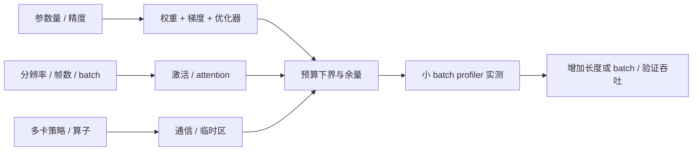

# 07 · GPU 显存、训练资源与部署预算

> 阅读目标：按参数状态、激活、工作区和 KV cache 分开核算资源，明确格式假设，并使用实测峰值验证。此章不提供随时间变化的显卡价格或排行榜。

## 1. 符号与显存组成

|符号|含义|单位 / 约定|
|---|---|---|
|$P,P_t$|总参数 / 可训练参数数|参数个数|
|$b_w,b_g,b_o,b_m$|权重 / 梯度 / 优化器 / master 字节|byte / 参数|
|$L,B,N,d,h$|层数、microbatch、序列长、宽度、query 头数|无量纲|
|$h_{kv},d_h,b_{kv}$|KV 头数、头宽、KV 每元素字节|GQA 的 h_kv 小于 h|
|$D,K_a,r$|数据并行卡数、累积步数、LoRA 秩|正整数|

$$M_{peak}\approx M_{weights}+M_{grads}+M_{opt}+M_{act}+M_{workspace}+M_{comm}+M_{allocator}.\tag{7.1}$$

这些组成的峰值不必同一时刻达到，逐项相加是预算近似。主机 RAM、磁盘、GPU VRAM 各自核算；缓存 reserved 与实际 allocated 不相同。

## 2. 参数状态：逐项乘字节

推导 1 · 全参数与部分训练、7B 示例

$$M_{state}\approx Pb_w+P_t(b_g+b_o+b_m).\tag{7.2}$$

全参训练 P_t=P。Adam 两个 FP32 moment 给 $b_o=8$；如独立 FP32 master 给 $b_m=4$。是否存在 master、梯度是否 FP32、状态是否低精度，取决于实现。

示例仅采用 BF16 权重 2B、BF16 梯度 2B、FP32 moments 8B、不含 master：

$$M_{state}=7\times10^9(2+2+8)=84\times10^9\ \mathrm{bytes}=84\ \mathrm{GB}\approx78.23\ \mathrm{GiB}.\tag{7.3}$$

增加 FP32 master 后为 112 GB ≈104.31 GiB。以上都未包括激活、临时区与通信，不能把它说成完整训练峰值。$1\mathrm{GB}=10^9$ bytes，$1\mathrm{GiB}=2^{30}$ bytes。

## 3. 激活、注意力与 KV cache

推导 2 · 为什么图像分辨率影响大，以及 KV 数量

常规 Transformer 激活包含若干 $B\times N\times d$ 张量，显式 attention 权重还有 $B\times h\times N\times N$：

$$M_{act}\sim O(LBNd)+O(LBhN^2).\tag{7.4}$$

这描述张量规模，常数、层间寿命和 fused 算子会改变峰值。图像长宽同时翻倍，ViT token 数近似增四倍，显式注意力元素增十六倍。FlashAttention 避免把完整权重矩阵写入显存，但不使一般全注意力计算量从二次自动变为线性。

增量推理每层缓存 K 与 V：

$$M_{KV}=2LBNh_{kv}d_hb_{kv}.\tag{7.5}$$

取 L=32、B=1、N=4096、h_kv=8、d_h=128、BF16 2B，得 536870912 bytes=0.5 GiB；改为 32 个 KV heads 时为 2 GiB。并发 batch 与上下文长度线性放大缓存，视觉和视频 token 也计入 N。

## 4. LoRA、分片与累积

推导 3 · 低秩参数量与理想分片下界

线性权重 $W\in\mathbb R^{d_{out}\times d_{in}}$ 的更新 $\Delta W=(\alpha/r)BA$，$B\in\mathbb R^{d_{out}\times r},A\in\mathbb R^{r\times d_{in}}$：

$$P_{LoRA}=r(d_{in}+d_{out}),\qquad\frac{P_{LoRA}}{P_W}=\frac{r(d_{in}+d_{out})}{d_{in}d_{out}}.\tag{7.6}$$

冻结主干省梯度 / 优化器，但权重仍存在，反传经过主干仍可能保留大量激活。量化主干和 LoRA 是两个独立选择。

理想 D 卡 ZeRO 状态存储（不含临时 all-gather、冗余和激活）：

$$\begin{aligned}M_{Z1}&\approx M_w+M_g+M_o/D,\\M_{Z2}&\approx M_w+(M_g+M_o)/D,\\M_{Z3}&\approx(M_w+M_g+M_o)/D.\end{aligned}\tag{7.7}$$

这里 M_o 含要分片的 optimizer / master 状态，具体分片配置可不同。通信 buffer、参数 materialization 和网络互联决定真实峰值及速度。

$$B_{effective}=B_{micro}\,K_a\,D.\tag{7.8}$$

累积仅降低单次激活峰值，参数状态不减；损失缩放、梯度同步和最后不完整 batch 需处理。checkpointing 以重算换内存；CPU offload 以带宽和主机内存换 VRAM。

## 5. 实测步骤与选型维度

1. 记录模型、可训练参数、精度、优化器、分片和 checkpoint 配置。
2. 分别测训练 forward/backward/update 峰值与推理 prefill/decode 峰值。
3. 同步 GPU 后统计 allocated / reserved 与耗时；记录框架、CUDA、驱动和设备。
4. 扫描 batch、序列、分辨率和去噪步数，记录吞吐、p95 延迟与 OOM 边界。
5. 选型比较容量、带宽、精度实际吞吐、互联、散热、电力和预算，使用目标任务 benchmark。

来源：[LoRA](https://arxiv.org/abs/2106.09685)、[ZeRO](https://arxiv.org/abs/1910.02054)、[FlashAttention](https://arxiv.org/abs/2205.14135)、[PyTorch 显存统计](https://docs.pytorch.org/docs/stable/notes/cuda.html#memory-management)。公式假设写在每节，不引用过时价格或统一硬件排行。
