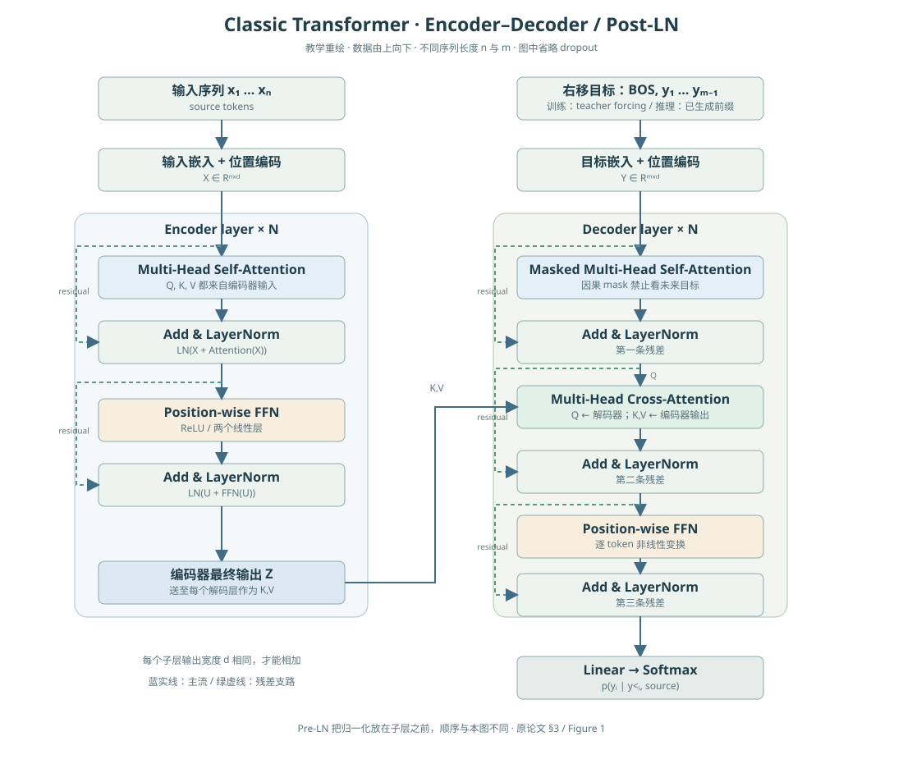
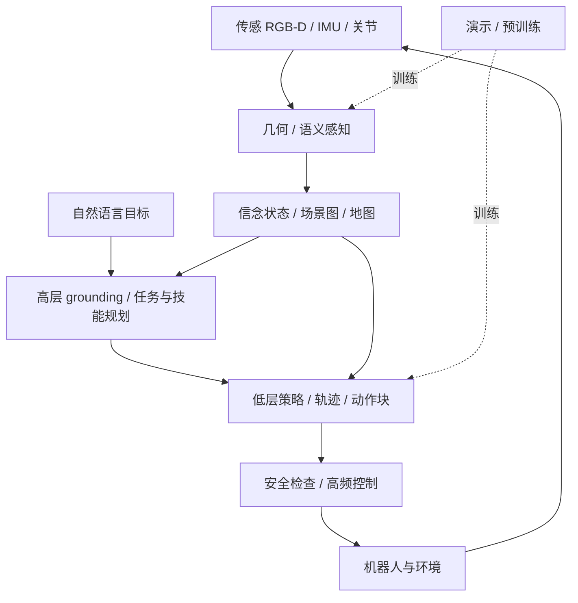
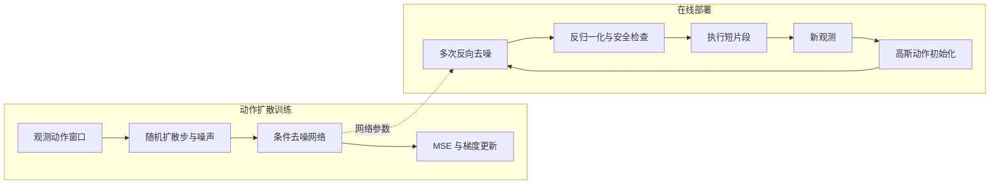
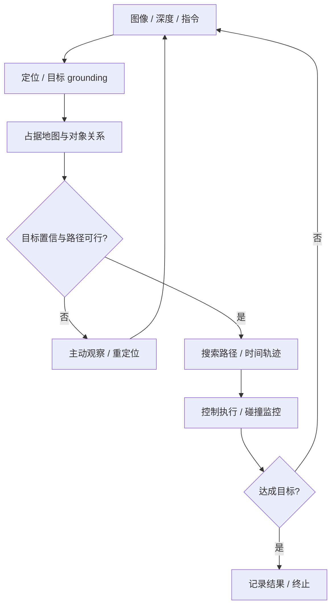

# 09 · 架构图与算法索引

本库所有架构与流程图均存成可离线显示的 SVG，点击图片可放大。每张图对应正文的维数、公式、流程和边界说明；图是教学重绘，而非截取论文图片。

## 1. 经典 Transformer

<figure class="diagram"><figcaption>含残差、Post-LN、masked self-attention、cross-attention 和右移目标。详细推导见 AI 章节第 3 节。</figcaption></figure>

[注意力、FFN、位置、mask、复杂度推导](02_AI与深度学习.md#3-经典-transformer完整编码器解码器)

## 2. 具身系统：高层与低层的闭环

离线训练箭头与在线信息流区分；状态估计会在任务执行中持续更新。[详见具身学习](06_具身学习与VLA.md)。

## 3. 训练流程与部署流程

训练每样本选随机噪声步；部署遍历采样器的多步过程。H、H_e 和 K_d 的定义见第 06 章。

## 4. 空间导航与恢复

## 5. 正文图索引

|图 / 算法|章节|配套说明|
|---|---|---|
|坐标链 / VAE|01|变换求逆、ELBO、重参数化|
|注意力 / ViT / DDPM|02|张量维数、mask、后验及训练目标|
|IK / 规划控制|03|阻尼求解、停止条件、轨迹接口|
|SLAM / NeRF|04|残差、规范自由度、透射积分|
|场景图 / 空间闭环|05|关系概率、主动观察、信念更新|
|Diffusion Policy / VLA|06|条件注入、动作接口、重规划|
|资源核算|07|状态与激活估算、profiler|
|评测流程|08|数据独立性、区间与失败归因|

## 6. 交互式直觉实验

[打开可调注意力、二连杆机械臂、空间参考系和资源估算](10_交互实验.html)。实验是解释公式的简化模型，不是性能 benchmark 或实机控制器。
