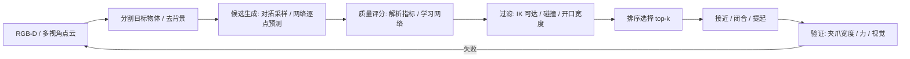

# 12 · 抓取、接触力学与灵巧操作

> 阅读目标：理解抓取为何是“接触力学 + 几何感知 + 柔顺控制”的组合问题；会用摩擦锥和抓取矩阵判断力封闭，推导平行夹爪的对拓条件和阻抗控制的参数选择，并知道学习方法在这条链中替代了哪一环。

## 1. 问题分层

|层次|问题|典型方法|输出|
|---|---|---|---|
|抓取位姿生成|从点云 / 图像找可行夹持位姿|几何采样 + 评分网络、端到端 6-DoF 预测|$(R,t,w)$ 位姿与开口宽度|
|抓取质量评估|这个位姿抓得稳吗|力封闭、ε 指标、学习评分|标量质量 / 成功概率|
|接近与执行|无碰撞到达、闭合|IK、运动规划、视觉伺服|关节轨迹|
|接触阶段控制|插入、擦拭、开门等受约束运动|阻抗 / 导纳控制、力位混合|期望力 / 刚度|
|灵巧操作|手内重定向、工具使用|RL + 仿真、遥操作模仿、触觉|多指关节指令|

## 2. 符号

|符号|含义|单位 / 约定|
|---|---|---|
|$c_i,n_i$|第 i 个接触点位置、内法向|米；单位向量，指向物体内部|
|$f_i=[f_{n},f_{t1},f_{t2}]$|接触局部坐标下的力|N；$f_n\ge0$ 只能推不能拉|
|$\mu$|库仑摩擦系数|无量纲|
|$w=[F;\ \tau]$|物体坐标系下的 wrench|N 与 N·m，与 03 章 twist 对偶|
|$G$|抓取矩阵|$6\times3k$，把接触力映射为物体 wrench|
|$M_d,D_d,K_d$|期望惯性、阻尼、刚度|阻抗控制参数|
|$e=x-x^*$|末端位置误差|米|

## 3. 接触模型与抓取矩阵

点接触带摩擦（hard finger）模型中，接触力必须位于摩擦锥：

$$\mathcal F_i=\left\{f_i:\ \sqrt{f_{t1}^2+f_{t2}^2}\le\mu f_n,\ f_n\ge0\right\}.\tag{12.1}$$

推导 1 · 从接触力到物体 wrench，以及摩擦锥线性化

接触 i 的局部坐标系旋转为 $R_i=[n_i,t_{i1},t_{i2}]$（物体系表达）。接触力在物体系为 $R_if_i$，它关于物体原点的力矩为 $c_i\times R_if_i$：

$$w_i=\begin{bmatrix}R_i\\ \hat c_iR_i\end{bmatrix}f_i=G_if_i,\qquad w=\sum_iG_if_i=Gf,\quad G=[G_1,\dots,G_k].\tag{12.2}$$

$\hat c$ 为叉乘反对称矩阵。圆锥约束是二阶锥，便于用 SOCP 求解；也常用 m 棱锥近似：取锥面母线 $s_{ij}=n_i+\mu(\cos\phi_jt_{i1}+\sin\phi_jt_{i2})$，令 $f_i=\sum_j\lambda_{ij}s_{ij},\ \lambda_{ij}\ge0$。内接棱锥偏保守，外接棱锥会高估可行力，需要说明采用哪一种。

**力封闭（force closure）**：对任意外部 wrench $w_{ext}$，都存在满足摩擦锥的接触力使 $Gf=-w_{ext}$。等价条件是：所有接触的锥面母线 wrench $G_is_{ij}$ 的凸包严格包含原点（正向张成整个 $\mathbb R^6$）。平面情形 wrench 是 3 维。

推导 2 · Ferrari–Canny ε 指标

把每个接触的法向力上限归一化（例如 $\sum_if_{n,i}\le1$），可达 wrench 集合为 $\mathcal W=\operatorname{ConvexHull}(\bigcup_{i,j}\{G_is_{ij}\})$。

$$\varepsilon=\min_{\|u\|=1}\ \max\{\,r:\ r\,u\in\mathcal W\,\}=\text{原点到 }\partial\mathcal W\text{ 的最短距离}.\tag{12.3}$$

含义：以单位总夹持力，抓取在“最差方向”上能抵抗的扰动 wrench 大小。ε>0 等价于力封闭。注意力矩与力单位不同，计算前要用特征长度（如物体半径）缩放力矩，否则 ε 随坐标原点和单位变化。Dex-Net 等工作用这类解析指标（再加位姿 / 摩擦扰动下的鲁棒性）大规模标注训练数据。

## 4. 平行夹爪：对拓抓取条件

两指平行夹爪是工业与研究中最常见的执行器。两接触点 $c_1,c_2$，连线方向 $u=(c_2-c_1)/\|c_2-c_1\|$。

推导 3 · 两接触点何时能“夹住”

两指只能沿连线互相挤压。忽略重力时，两接触力需大小相等、方向相反并共线于 u，才能使合力与合力矩为零。接触 1 的力方向为 u，必须在摩擦锥内：

$$\angle(u,n_1)\le\arctan\mu,\qquad\angle(-u,n_2)\le\arctan\mu.\tag{12.4}$$

即连线与两侧内法向的夹角都不超过摩擦角。μ=0.5 时摩擦角约 26.6°。这就是“对拓点（antipodal）”采样的依据：在点云上取一点和其法向，沿法向射线找对侧表面点，检查两侧夹角与开口宽度 $\|c_2-c_1\|<w_{max}$。

重力与惯性扰动还需要摩擦提供切向力：竖直提起质量 m 的物体时，两侧摩擦合力 $2\mu f_n\ge mg$，所以夹持力至少 $f_n\ge mg/(2\mu)$。例：0.5 kg、μ=0.5，需约 4.9 N，留安全系数 2 则设 10 N。

## 5. 学习式抓取：从采样评分到端到端

|路线|代表|输入 → 输出|特点|
|---|---|---|---|
|采样 + 评分|Dex-Net / GQ-CNN|深度图块 → 成功概率|合成数据大规模标注；平面抓取|
|逐点 6-DoF|Contact-GraspNet、GraspNet-1Billion 基线、AnyGrasp|点云 → 每点的抓取姿态与宽度|杂乱场景；需相机外参与碰撞过滤|
|生成式|基于 VAE / 扩散的抓取生成|点云 → 抓取分布|覆盖多模态，需评分器筛选|
|语义 / 任务抓取|结合 VLM 的部位选择|语言 + 图像 → 抓取区域|“抓杯柄而非杯口”需要语义|
|端到端策略|DP / VLA（06、17）|图像 → 动作序列|抓取隐含在动作中，难单独评测|

抓取表示常为 $g=(R\in SO(3),t\in\mathbb R^3,w)$。逐点方法常把抓取参数化为“接触点 + 接近方向 + 绕接近轴的旋转 + 宽度”，降低回归难度。评测使用真实物体成功率（提起并保持若干秒）、清台率和每次抓取时间。

## 6. 接触阶段：阻抗控制与力位混合

纯位置控制在接触时会因微小误差产生巨大力（刚性环境）。阻抗控制让末端表现为“质量—弹簧—阻尼”：

$$M_d\ddot e+D_d\dot e+K_de=F_{ext}.\tag{12.5}$$

推导 4 · 任务空间阻抗控制律与临界阻尼

任务空间动力学 $\Lambda(x)\ddot x+\mu(x,\dot x)+p(x)=F+F_{ext}$（$\Lambda=(JM^{-1}J^\top)^{-1}$）。若取 $M_d=\Lambda$，所需控制力简化为

$$F=-K_de-D_d\dot e+\mu+p+\Lambda\ddot x^*,\qquad\tau=J^\top F.\tag{12.6}$$

代入动力学消去非线性项，得到式 (12.5)。单轴看是二阶系统，固有频率 $\omega_n=\sqrt{K_d/M_d}$，阻尼比 $\zeta=D_d/(2\sqrt{K_dM_d})$。取 ζ=1 临界阻尼：$D_d=2\sqrt{K_dM_d}$，接触时不振荡。

例：有效质量 2 kg，期望刚度 500 N/m，则 $D_d=2\sqrt{1000}\approx63$ N·s/m；若位置误差 1 cm 推到刚性桌面，稳态接触力约 5 N。刚度越低越安全但跟踪精度越差。导纳控制是对偶形式：测力 → 计算期望运动 → 内环位置控制，适合高减速比、难以力矩控制的工业臂。

力位混合控制用选择矩阵 S 在约束方向控力、在自由方向控位置：例如擦桌面时 z 向控制 10 N 法向力，x-y 向跟踪轨迹。插孔（peg-in-hole）常用螺旋搜索 + 低刚度 + 力阈值判断。

## 7. 触觉与灵巧手

视觉在接触瞬间常被手指遮挡，触觉补充接触位置、力分布和滑移。光学触觉（GelSight 类）用相机拍摄弹性体表面形变，通过光度立体从多色光照强度恢复表面法向，再积分得高度图；剪切标记点的位移场反映切向力与初始滑移。

|主题|核心难点|常用方法|
|---|---|---|
|手内重定向|接触切换、欠驱动、高维（16–24 DoF）|仿真中大规模 RL + 域随机化，教师—学生蒸馏|
|遥操作采集|人手与机械手形态不同|手部关键点估计 + 运动重定向优化|
|工具使用|工具—环境接触|分阶段策略、力控、示教|
|可变形物体|状态维度高|关键点 / 粒子表示、学习动力学|

推导 5 · 人手到机械手的运动重定向

给定人手关键点（指尖、指根）$h_k$，机械手正运动学 $p_k(q)$，求关节角使对应关键点向量匹配，同时保持平滑：

$$q_t^*=\arg\min_{q\in[q_{min},q_{max}]}\sum_k\left\|(p_k(q)-p_0(q))-s\,(h_k-h_0)\right\|^2+\beta\|q-q_{t-1}^*\|^2.\tag{12.7}$$

用相对手腕 $p_0$ 的向量消除全局位置；s 为尺寸缩放。第二项抑制帧间抖动。这是非线性最小二乘，可用 03 章阻尼 IK 的迭代求解，以上一帧解为初值实时运行。

## 8. 局限与实践提示

- 解析指标假设刚体、已知摩擦与精确接触点，实物的摩擦系数和点云噪声会让高分抓取失败；鲁棒性评估需在扰动下采样。
- 抓取成功不等于任务成功：倒水需要抓杯身且保持竖直，任务约束要进入评分。
- 柔顺控制参数要和控制频率、传感器延迟匹配；力传感器零漂需定期标定。
- 学习抓取的训练物体集合与测试集合要明确划分（seen / unseen objects），报告每类成功率。

来源：[Modern Robotics 第 12 章 抓取与操作](https://modernrobotics.northwestern.edu/)、Ferrari & Canny (ICRA 1992) 抓取质量指标、[Dex-Net 2.0](https://arxiv.org/abs/1703.09312)、[GraspNet-1Billion](https://graspnet.net/)、[Contact-GraspNet](https://arxiv.org/abs/2103.14127)、Hogan (1985) 阻抗控制、[GelSight 触觉传感器](https://www.mdpi.com/1424-8220/17/12/2762)、[OpenAI 灵巧手内操作](https://arxiv.org/abs/1808.00177)、[AnyTeleop](https://arxiv.org/abs/2307.04577)。
