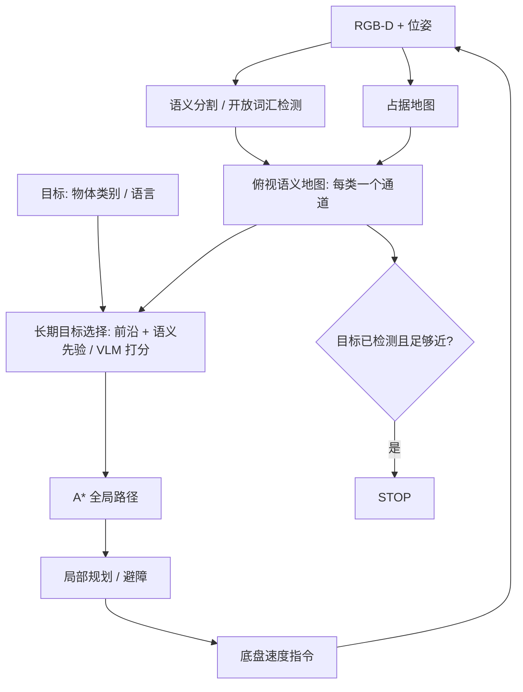

# 13 · 移动导航、主动探索与视觉语言导航

> 阅读目标：从占据栅格的贝叶斯更新出发，理解全局规划、局部避障和前沿探索的分工；再看语义导航（ObjectNav）与视觉语言导航（VLN）如何把“去厨房找杯子”这样的目标落到地图与动作上。

## 1. 任务谱系与评测

|任务|目标给定方式|典型环境 / 数据|核心难点|
|---|---|---|---|
|PointNav|相对目标坐标|Habitat / Gibson / MP3D|无地图时的定位与避障|
|ObjectNav|物体类别，如“椅子”|HM3D、MP3D|语义先验、探索效率|
|ImageNav|目标位置拍的一张图|Habitat|视角匹配|
|VLN|自然语言路线指令|R2R、RxR、VLN-CE|指令—视觉对齐、进度跟踪|
|EQA / 主动问答|问题，需要先探索再回答|EQA、OpenEQA|何时停止探索|
|社交 / 动态导航|在行人中移动|仿真人群、实机|行为预测、礼让|

指标：成功率 SR、SPL（成功按路径效率加权，见 08 章）、到目标距离 DTG；VLN 常加 nDTW 衡量路径与参考路径的贴合度：

$$\operatorname{nDTW}(P,R)=\exp\left(-\frac{\operatorname{DTW}(P,R)}{|R|\cdot d_{th}}\right),\tag{13.1}$$

DTW 为两条路径点序列在动态时间规整下的最小累计距离，$|R|$ 为参考路径点数，$d_{th}$ 为成功距离阈值（R2R 常用 3 m）。

## 2. 符号

|符号|含义|约定|
|---|---|---|
|$m_i\in\{0,1\}$|栅格 i 是否被占据|二值随机变量|
|$l_{t,i}$|栅格 i 的对数几率|$\log\frac{P(m_i=1)}{P(m_i=0)}$|
|$x_t,z_t$|机器人位姿、传感器观测|位姿由 SLAM / 里程计给出|
|$g(n),h(n)$|A* 已走代价、启发式|单位与边代价一致|
|$(v,\omega)$|线速度、角速度指令|m/s、rad/s，差速底盘|
|$\mathcal F$|前沿集合|已知空闲且邻接未知的栅格|

## 3. 占据栅格：对数几率更新

推导 1 · 从贝叶斯公式到加法更新

假设栅格相互独立、地图静态，对单个栅格：

$$P(m\mid z_{1:t})=\frac{P(z_t\mid m)P(m\mid z_{1:t-1})}{P(z_t\mid z_{1:t-1})}=\frac{P(m\mid z_t)P(z_t)}{P(m)}\cdot\frac{P(m\mid z_{1:t-1})}{P(z_t\mid z_{1:t-1})}.\tag{13.2}$$

第二个等号对 $P(z_t\mid m)$ 再用一次贝叶斯公式。对 $\neg m$ 写同样的式子后两式相除，未知的归一化项 $P(z_t)$、$P(z_t\mid z_{1:t-1})$ 消去：

$$\frac{P(m\mid z_{1:t})}{P(\neg m\mid z_{1:t})}=\frac{P(m\mid z_t)}{P(\neg m\mid z_t)}\cdot\frac{P(\neg m)}{P(m)}\cdot\frac{P(m\mid z_{1:t-1})}{P(\neg m\mid z_{1:t-1})}.\tag{13.3}$$

取对数，乘法变加法：

$$l_t=l_{t-1}+\underbrace{\log\frac{P(m\mid z_t)}{1-P(m\mid z_t)}}_{\text{逆传感器模型}}-l_0.\tag{13.4}$$

数值例：先验 0.5（$l_0=0$），激光击中某栅格时逆传感器模型给 $P=0.7$，每次加 $\ln(0.7/0.3)\approx0.847$。连续三次击中后 $l=2.54$，概率 $1/(1+e^{-2.54})\approx0.927$。激光穿过的栅格用 $P=0.4$ 减分。实现时把 l 截断在 $[l_{min},l_{max}]$，保证动态物体离开后地图能更新。

## 4. 全局规划与代价地图

导航把栅格转为代价地图：障碍按机器人半径膨胀（inflation），离障碍越近代价越高，未知区域可视为高代价或不可通行。A* 弹出 $f=g+h$ 最小的节点。

推导 2 · 可采纳启发式为何保证最优

若对所有节点 $h(n)\le h^*(n)$（真实剩余最短代价），称 h 可采纳。设最优路径代价 $C^*$，A* 以代价 $C>C^*$ 的路径首次弹出目标。此时开表中一定还有最优路径上的某节点 n'（起点在最优路径上，且目标尚未经由最优路径弹出），它满足

$$f(n')=g^*(n')+h(n')\le g^*(n')+h^*(n')=C^*<C=f(goal),\tag{13.5}$$

与“目标的 f 最小才被弹出”矛盾。若还满足一致性 $h(n)\le c(n,n')+h(n')$，每个节点首次弹出时 g 已最优，无需重开节点。八邻域栅格上欧氏距离可采纳；曼哈顿距离在允许对角移动时会高估，不可采纳。

|规划器|适用|说明|
|---|---|---|
|Dijkstra / A*|2D 栅格全局路径|启发式加速；分辨率决定精度与计算量|
|Hybrid A* / 状态格|有最小转弯半径的车辆|搜索空间含朝向，满足非完整约束|
|RRT / RRT*|高维或连续空间|见 03 章；需后处理平滑|
|D* Lite|地图在线变化|增量重规划，复用之前搜索结果|

## 5. 局部规划：DWA 与 MPC

全局路径只考虑静态地图；局部规划器以 10–20 Hz 处理动态障碍和动力学限制。DWA（动态窗口法）在当前速度可达的窗口内采样 $(v,\omega)$，前向模拟短时轨迹并评分：

$$J(v,\omega)=\alpha\cdot\text{heading}+\beta\cdot\text{clearance}+\gamma\cdot\text{velocity},\quad(v,\omega)\in V_s\cap V_d\cap V_a.\tag{13.6}$$

$V_s$ 为速度上限，$V_d$ 为一个控制周期内加速度可达范围，$V_a$ 为能在碰撞前停下的安全速度集合。MPC 局部规划则显式优化一段控制序列并加约束（见 03 章式 3.10），对动态障碍可以加入预测轨迹。

## 6. 主动探索：前沿与信息增益

未知环境中，机器人需决定“下一步去哪看”。前沿（frontier）是已知空闲区与未知区的边界。

推导 3 · 前沿效用与信息增益

对每个前沿簇 f，估计到达代价 $C(f)$（A* 路径长度）和到达后可观测未知区域的信息增益。以栅格熵度量地图不确定性：

$$\mathcal H(m)=-\sum_i\left[p_i\log p_i+(1-p_i)\log(1-p_i)\right],\quad U(f)=\mathbb E[\mathcal H(m)-\mathcal H(m\mid z_f)]-\lambda C(f).\tag{13.7}$$

未知栅格 p=0.5 时熵最大（1 bit），所以信息增益可近似为传感器视野内未知栅格数。λ 权衡“走得远但看得多”与“就近探索”。这是 05 章式 (5.7) 主动观测原则在地图上的具体化。ObjectNav 中还可以把“目标物体出现在 f 附近的语义概率”乘进效用，例如“床更可能在卧室”。

## 7. 语义导航：模块化与端到端

|路线|代表|思路|
|---|---|---|
|端到端 RL|DD-PPO|大规模分布式 PPO，RGB-D → 动作；PointNav 近乎完美，但语义任务样本效率低|
|模块化语义地图|SemExp|学习“长期目标”策略，配合地图与经典规划|
|开放词汇地图|VLMaps、ConceptFusion|把 CLIP / LSeg 等像素特征投影到地图，可用任意文本查询|
|VLM 前沿打分|VLFM|用视觉语言模型对前沿方向计算“与目标相关”的价值图|
|LLM 规划|LM-Nav、NavGPT 类|语言模型分解指令、选择地标，几何由导航栈完成|

开放词汇地图的查询：对地图栅格特征 $\phi_i$ 与文本嵌入 $\psi(\text{"sofa"})$ 计算余弦相似度，取 top 区域作为候选目标；多个文本提示做 softmax 对比（含“其他”“地面”等负类）可减少误检。

## 8. 视觉语言导航

VLN 输入指令如“出门左转，穿过走廊，在第二扇门前停下”。离散 VLN（R2R）在预先采样的全景节点图上跳转；连续 VLN-CE 输出底层速度动作，更接近实机。

推导 4 · 跨模态注意力与进度监督

指令 token 特征 $U\in\mathbb R^{L\times d}$，当前全景 K 个候选方向的视觉特征 $V_t\in\mathbb R^{K\times d}$，智能体状态 $h_t$。文本注意力找到“当前该执行的子指令”，再用它为候选方向打分：

$$\alpha_t=\operatorname{softmax}\left(\frac{Uh_t}{\sqrt d}\right),\quad\tilde u_t=\alpha_t^\top U,\quad P(a_t=k)=\operatorname{softmax}_k\left(v_{t,k}^\top W[\tilde u_t;h_t]\right).\tag{13.8}$$

注意力分布在指令上的位置可视为“读到哪了”。进度监督额外回归 $\hat p_t\approx 1-d_t/d_0$（剩余距离比例），帮助学会何时停止。现代方法用预训练多模态 Transformer、拓扑图记忆与航点预测器，把连续环境转化为“选择下一个航点”。

常见失败：转向词“左 / 右”与自我中心参考系混淆（见 05 章参考系），地标在当前视角不可见，过早停止或绕圈。分析时按指令子句对齐轨迹，标注失败发生在哪一步。

## 9. 局限与实践提示

- 仿真导航的碰撞模型、传感器噪声与实机差别大；Sim2Real 需在实机上重测 SR / SPL，并报告人工干预次数。
- 语义地图依赖定位精度，SLAM 漂移会把同一物体映射到多处；需要实例融合与回环。
- 开放词汇检测对少见物体和否定描述（“不是红色的那个”）不可靠，最终决策应结合几何验证。
- 动态环境中“地图静态”假设失效，需单独的动态障碍跟踪层。

来源：Thrun, Burgard & Fox《Probabilistic Robotics》（占据栅格、逆传感器模型）、[Habitat](https://aihabitat.org/)、[DD-PPO](https://arxiv.org/abs/1911.00357)、[SemExp](https://arxiv.org/abs/2007.00643)、[VLMaps](https://arxiv.org/abs/2210.05714)、[VLFM](https://arxiv.org/abs/2312.03275)、[R2R](https://arxiv.org/abs/1711.07280)、[VLN-CE](https://arxiv.org/abs/2004.02857)、[nDTW](https://arxiv.org/abs/1907.05446)、Yamauchi (1997) 前沿探索、Fox et al. (1997) DWA。
