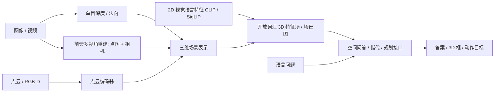
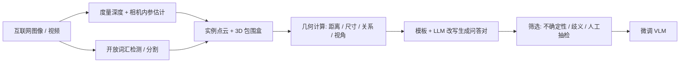

# 14 · 三维基础模型、开放词汇场景理解与空间推理

> 阅读目标：理解点云网络为什么要“置换不变”；单目深度为什么用尺度—平移不变损失；DUSt3R / VGGT 类前馈重建如何绕开传统 SfM；怎样把 2D 视觉语言特征提升到 3D；以及空间推理能力如何分类、构造数据和评测。本章接续 04（几何重建）与 05（空间状态与关系）。

## 1. 能力地图

|符号|含义|约定|
|---|---|---|
|$X=\{x_i\}_{i=1}^N$|点集|$x_i\in\mathbb R^3$（可附颜色、法向）|
|$\hat d,d$|预测与真值深度 / 逆深度|单目预测通常只到相对尺度|
|$s,t$|尺度与平移|对齐预测与真值的闭式参数|
|$X^{1,1},X^{2,1}$|点图|两张图像素在第 1 张相机坐标系下的 3D 点|
|$C^{v,1}$|点图置信度|逐像素，正值|
|$f_v(u),\phi_p$|视角 v 像素 u 的语言对齐特征、3D 点特征|单位向量（余弦相似度）|

## 2. 点云网络：置换不变与层次结构

点云没有规则网格与固定顺序，同一物体打乱点序必须得到相同结果。

推导 1 · 对称函数构造与 PointNet

置换不变函数可写为 $F(\{x_1,\dots,x_N\})=\gamma\left(\max_{i}h(x_i)\right)$：h 为逐点共享 MLP，逐维 max 是对称函数，γ 为后续 MLP。交换任意两点不改变 max 的结果，因此 F 不变。PointNet 证明此类结构可以任意逼近 Hausdorff 连续的集合函数（给定足够宽的 h）。

$$F(X)=\gamma\left(\operatorname{MAX}_{i=1..N}\{h(x_i)\}\right),\quad h:\mathbb R^3\to\mathbb R^K.\tag{14.1}$$

全局 max 只捕捉整体形状，缺少局部邻域结构。PointNet++ 用最远点采样选中心、球查询分组、组内跑小 PointNet，逐层抽象（set abstraction），类似 CNN 的感受野扩大。Point Transformer 用相对位置编码的局部向量注意力；稀疏卷积（MinkowskiEngine 类）把点体素化后只在非空体素上卷积，常用于大场景语义分割。

## 3. 单目深度：尺度—平移不变

单张图像的绝对尺度不可观（小模型近拍与大建筑远拍可能成像相同），跨数据集混合训练时各数据集深度单位和基线也不同。MiDaS 系列用对齐后再计算误差的损失。

推导 2 · 最小二乘尺度—平移对齐的闭式解

对一张图的有效像素集合，求 s, t 使 $s\hat d_i+t$ 最接近真值（通常在逆深度 / 视差空间）：

$$(s^*,t^*)=\arg\min_{s,t}\sum_i(s\hat d_i+t-d_i)^2.\tag{14.2}$$

令 $\vec h_i=[\hat d_i,1]^\top$，正规方程为

$$\begin{bmatrix}\sum\hat d_i^2&\sum\hat d_i\\\sum\hat d_i&N\end{bmatrix}\begin{bmatrix}s\\t\end{bmatrix}=\begin{bmatrix}\sum\hat d_id_i\\\sum d_i\end{bmatrix},\quad s^*=\frac{\operatorname{Cov}(\hat d,d)}{\operatorname{Var}(\hat d)},\ t^*=\bar d-s^*\bar{\hat d}.\tag{14.3}$$

损失 $L_{ssi}=\frac1N\sum_i(s^*\hat d_i+t^*-d_i)^2$ 对尺度和平移不敏感，可混合不同来源的数据。部署时若需要米制深度，必须另有尺度来源：双目基线、已知物体尺寸、IMU / 里程计，或专门的米制深度模型（如 Depth Anything 的 metric 版本、Metric3D 类方法），它们依赖相机内参并对域外场景敏感。

Depth Anything 等模型通过大规模无标注图像的伪标签自训练提高泛化；输出相对深度时可用 RGB-D 少量像素拟合 s, t 后用于机器人，但对透明、反光、细杆仍应以深度传感器为准。

## 4. 前馈多视角重建：点图回归

传统流程：特征匹配 → 本质矩阵 → 三角化 → 光束法平差（04 章因子图）。DUSt3R 直接从两张图回归“点图”：每个像素在第一台相机坐标系中的 3D 坐标。

推导 3 · 置信度加权的点图损失

网络输出 $X^{v,1}\in\mathbb R^{H\times W\times3}$ 与置信度 $C^{v,1}$。由于整体尺度不可观，预测与真值分别按平均距离归一化（$z,\bar z$），回归损失

$$\ell_{reg}(v,i)=\left\|\frac{X_i^{v,1}}{z}-\frac{\bar X_i^{v,1}}{\bar z}\right\|,\quad L_{conf}=\sum_{v}\sum_iC_i^{v,1}\ell_{reg}(v,i)-\alpha\log C_i^{v,1}.\tag{14.4}$$

对 C 求导令其为零得 $C^*=\alpha/\ell_{reg}$：误差大的像素（天空、反光、遮挡）自动获得低置信，且 $-\log C$ 防止把所有 C 压到 0。相机内参可从点图反推：对第一视角，像素 (u,v) 与点 $(X,Y,Z)$ 满足针孔投影，最小化重投影误差即可估焦距；两视角相对位姿用 Procrustes / PnP（见 04 章 ICP 的 SVD 解）。

|方法|输入|输出|要点|
|---|---|---|---|
|DUSt3R|图像对|两张点图 + 置信度|多图需全局对齐优化|
|MASt3R|图像对|点图 + 局部匹配描述子|提升匹配精度，可做度量尺度|
|VGGT|任意数量图像|相机、深度、点图、跟踪|单次前馈输出，免逐场景优化|
|单目深度|单图|相对 / 米制深度|无多视角一致性保证|

对具身系统，前馈重建的价值是“快速给出可用几何先验”；用于抓取或碰撞时仍需与深度传感器融合并估计不确定性。

## 5. 开放词汇三维：把 2D 语义提升到 3D

推导 4 · 多视角特征融合与文本查询

3D 点 p 投影到视角 v 的像素 $u_v=\pi(K_v,T_v,p)$。若该点在 v 中可见（深度测试通过），取像素级语言对齐特征 $f_v(u_v)$，按权重融合：

$$\phi_p=\operatorname{normalize}\left(\frac{\sum_v w_{v,p}\,f_v(u_v)}{\sum_vw_{v,p}}\right),\quad w_{v,p}=\mathbb 1[\text{可见}]\cdot\kappa(\text{距离},\text{视角}).\tag{14.5}$$

对文本提示集合 $\{t_j\}$ 计算 $P(j\mid p)=\operatorname{softmax}_j(\phi_p^\top\psi(t_j)/\tau)$。只有单个提示时余弦相似度没有绝对阈值，需要加入“物体 / 东西 / 墙 / 地面”等通用负类做对比，或按场景内相对排名取 top 区域。OpenScene 把融合特征蒸馏到 3D 网络；ConceptGraphs 先做实例分割与跨帧关联，再给每个实例节点附上特征与描述，形成可查询的开放词汇场景图（与 05 章场景图对接）。LERF 把语言特征嵌入辐射场，可渲染任意视角的相关度图。

## 6. 空间推理：能力分类与数据构造

|能力|示例问题|几何依据|
|---|---|---|
|度量估计|桌子多高？两物相距多远？|米制深度、尺寸先验|
|相对关系|杯子在书的左边吗？|参考系 + 关系阈值（05 章式 5.1）|
|拓扑 / 包含|钥匙在抽屉里吗？|包围盒 / 网格包含与支撑|
|视角转换|从门口看，沙发在左还是右？|坐标系变换到他者视角|
|心理旋转|这两个形状旋转后相同吗？|SO(3) 对齐|
|计数与出现顺序|视频中出现了几把椅子？先看到什么？|实例跟踪与去重|
|路线规划|从冰箱走到门怎么走？|地图 + 路径|

推导 5 · 视角转换：把关系计算放到他者坐标系

观察者 A 位于 $t_{WA}$，朝向由 $R_{WA}$ 给出（列为 A 的前、左、上轴在世界系的表达）。物体 B 在 A 视角的坐标为

$$p^A=R_{WA}^\top\left(p_B^W-t_{WA}\right),\qquad\text{“在 A 左侧”}\iff[p^A]_{l}>\tau.\tag{14.6}$$

这就是 05 章式 (5.1) 在 $f,l,n$ 取 $R_{WA}$ 各列时的写法。模型常见错误是默认使用相机视角，所以问题中出现“从某人的角度”“面朝门时”应先显式确定 $R_{WA}$。数值例：A 在原点面朝世界 +y（前 = (0,1,0)，左 = (−1,0,0)），物体在 (−2,1,0)，则 $p^A=(1,2,0)$：前方 1 m、左侧 2 m。

SpatialVLM、SpatialRGPT 一类工作用上述“数据引擎”把度量几何转成大规模问答数据，补足互联网图文中稀缺的定量空间监督。3D-LLM、LEO 等直接以点云 / 3D 特征为输入。视频空间推理（如 VSI-Bench 提出的问题集合）要求模型从第一人称视频形成场景的整体布局，研究中常让模型先输出“认知地图”（俯视网格中各物体位置）再回答，以检验中间表示是否正确。

|基准|输入|考察|
|---|---|---|
|BLINK|图像|深度、对应、多视角等感知|
|ScanQA / SQA3D|3D 扫描（+ 情境描述）|3D 问答；SQA3D 要求从给定位置朝向推理|
|VSI-Bench|室内视频|计数、尺寸、距离、相对方向、路线、出现顺序|
|Habitat / EQA 类|交互环境|先探索后回答|

## 7. 局限与研究提示

- 互联网图像的米制深度伪标签有系统误差，问答数据中的数值答案应附容差，评测用相对误差区间而非精确匹配。
- 关系标签依赖参考系与阈值，数据生成脚本必须写明；同一句“在左边”在相机系和物体自身朝向下答案不同。
- 开放词汇 3D 的“语义正确”不代表几何边界准确，抓取前仍需实例级分割与点云验证。
- 3D 基础模型在室内数据集上训练居多，室外、工业场景和透明物体泛化有限。

来源：[PointNet](https://arxiv.org/abs/1612.00593)、[PointNet++](https://arxiv.org/abs/1706.02413)、[Point Transformer](https://arxiv.org/abs/2012.09164)、[MiDaS](https://arxiv.org/abs/1907.01341)、[Depth Anything](https://arxiv.org/abs/2401.10891)、[DUSt3R](https://arxiv.org/abs/2312.14132)、[MASt3R](https://arxiv.org/abs/2406.09756)、[VGGT](https://arxiv.org/abs/2503.11651)、[OpenScene](https://arxiv.org/abs/2211.15654)、[ConceptGraphs](https://arxiv.org/abs/2309.16650)、[LERF](https://arxiv.org/abs/2303.09553)、[3D-LLM](https://arxiv.org/abs/2307.12981)、[LEO](https://arxiv.org/abs/2311.12871)、[SpatialVLM](https://arxiv.org/abs/2401.12168)、[SpatialRGPT](https://arxiv.org/abs/2406.01584)、[Thinking in Space / VSI-Bench](https://arxiv.org/abs/2412.14171)、[BLINK](https://arxiv.org/abs/2404.12390)、[ScanQA](https://arxiv.org/abs/2112.10482)、[SQA3D](https://arxiv.org/abs/2210.07474)。方法描述为教学概括，细节以原文为准。
