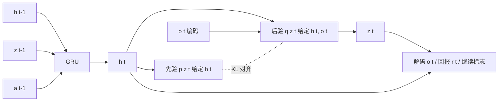

# 15 · 世界模型：潜动力学、视频生成与想象中规划

> 阅读目标：区分“能生成好看的未来画面”和“能用于决策的动力学模型”；推导序列潜变量模型（RSSM）的变分下界，理解在想象轨迹里训练策略和用 CEM / MPC 规划的流程；认识视频生成式世界模型与嵌入预测式（JEPA）世界模型的取舍。本章扩展 05 章第 6 节。

## 1. 什么是世界模型

工作定义：给定历史观测与（候选）动作，预测未来状态、观测或回报的模型 $p(s_{t+1:t+H}\mid s_{\le t},a_{t:t+H-1})$。按预测对象分为：

|类型|预测什么|代表|主要用途|
|---|---|---|---|
|解析 / 物理仿真|刚体动力学、接触|MuJoCo、Isaac 等仿真器|RL 训练、MPC|
|潜动力学模型|紧凑潜状态 + 回报|World Models、PlaNet、Dreamer、TD-MPC|样本高效 RL、规划|
|视频生成世界模型|未来像素（动作 / 文本条件）|UniSim、Genie、Cosmos 类|数据生成、策略评测、交互仿真|
|嵌入预测模型|未来的表征而非像素|JEPA 系列（V-JEPA 2 等）|表征学习、潜空间规划|

判断一个世界模型是否“可用于决策”，至少看三点：对动作是否敏感（可控性）、多步预测误差如何累积（05 章式 5.5）、能否预测与任务相关的量（接触、成功、回报）。

## 2. 符号

|符号|含义|约定|
|---|---|---|
|$h_t$|确定性循环状态|GRU 隐状态|
|$z_t$|随机潜状态|高斯或离散类别|
|$s_t=(h_t,z_t)$|模型状态|用于预测观测与回报|
|$q_\phi(z_t\mid h_t,o_t)$|后验（编码器）|看到当前观测|
|$p_\theta(z_t\mid h_t)$|先验（转移）|不看当前观测，用于想象|
|$p_\theta(o_t\mid s_t),p_\theta(r_t\mid s_t)$|解码器、回报头|训练信号|
|$H$|想象 / 规划时域|步数|

## 3. RSSM：确定性路径 + 随机路径

纯随机转移难以长期记忆，纯确定性转移无法表达多种可能未来。RSSM 用 $h_t=f_\theta(h_{t-1},z_{t-1},a_{t-1})$ 携带记忆，用 $z_t$ 表达不确定性。

推导 1 · 序列变分下界（ELBO）

目标是最大化给定动作序列下观测的对数似然。引入后验 $q(z_{1:T}\mid o_{1:T},a_{1:T})=\prod_tq(z_t\mid h_t,o_t)$，生成模型 $p(o_{1:T},z_{1:T}\mid a)=\prod_tp(z_t\mid h_t)p(o_t\mid h_t,z_t)$，由 Jensen 不等式：

$$\log p(o_{1:T}\mid a_{1:T})=\log\mathbb E_q\left[\frac{p(o_{1:T},z_{1:T}\mid a)}{q(z_{1:T}\mid o,a)}\right]\ge\mathbb E_q\left[\sum_t\log\frac{p(o_t\mid s_t)\,p(z_t\mid h_t)}{q(z_t\mid h_t,o_t)}\right].\tag{15.1}$$

把每个时间步的比值拆开，得到“重建项 − KL 项”：

$$\mathcal L=\sum_{t=1}^T\Big(\mathbb E_q[\log p(o_t\mid s_t)+\log p(r_t\mid s_t)]-\mathbb E_q\big[D_{KL}(q(z_t\mid h_t,o_t)\,\|\,p(z_t\mid h_t))\big]\Big).\tag{15.2}$$

回报项是把回报也当作观测的一部分建模。KL 项迫使“不看观测的先验”尽量接近“看了观测的后验”，这样在想象时只用先验也能得到合理状态。这与 01 章 VAE 的 ELBO 推导同构，只是潜变量变成了随时间相关的序列，h 由过去的 z 决定。

推导 2 · KL 平衡与 free bits

KL 项同时训练先验（向后验靠拢）和后验（向先验靠拢、丢弃信息）。DreamerV2 起采用 KL 平衡，用 stop-gradient sg 分开两种作用：

$$L_{KL}=\beta_{dyn}\,D_{KL}(\operatorname{sg}(q)\,\|\,p)+\beta_{rep}\,D_{KL}(q\,\|\,\operatorname{sg}(p)),\quad\beta_{dyn}>\beta_{rep}.\tag{15.3}$$

前一项只更新先验（学好动力学），后一项只轻微约束后验（避免表示过于复杂）。free bits：$\max(1,D_{KL})$，KL 已低于 1 nat 时不再惩罚，防止后验坍缩到先验、潜变量不携带信息。DreamerV3 还使用 symlog 变换回报与价值，使同一组超参数跨不同回报尺度的任务可用。

## 4. 在想象中学习策略

世界模型训练好后，从真实数据中的后验状态出发，只用先验和策略向前展开 H 步，得到想象轨迹，在其上训练 actor-critic，不需要额外的真实交互。

推导 3 · λ-回报作为价值目标

想象轨迹上回报预测 $\hat r_t$、继续概率 $\hat c_t$（是否未终止）、价值 $v_\psi$。λ-回报递归定义为

$$R_t^\lambda=\hat r_t+\gamma\hat c_t\left[(1-\lambda)v_\psi(s_{t+1})+\lambda R_{t+1}^\lambda\right],\quad R_H^\lambda=v_\psi(s_H).\tag{15.4}$$

λ=0 为一步自举，λ=1 为 H 步回报加末端价值，与 11 章 GAE 的插值思想相同。critic 回归 $R_t^\lambda$；actor 最大化 $R_t^\lambda$，梯度可以通过可微的动力学反传（连续控制）或用 REINFORCE（离散动作），并加熵正则。想象时域 H 一般只有十几步，因为模型误差随步数增长；末端价值弥补了短时域。

## 5. 用世界模型规划：CEM 与 MPC

不训练显式策略，也可以每一步在线优化动作序列（05 章式 5.6）。交叉熵方法（CEM）是无梯度的采样优化器，适合非凸、带离散分支的目标。

推导 4 · CEM 更新与滚动执行

维护动作序列的对角高斯 $\mathcal N(\mu,\operatorname{diag}\sigma^2)$，维度 $H\times d_a$。每次迭代：

1. 采样 N 条动作序列 $A^{(n)}\sim\mathcal N(\mu,\sigma^2)$，裁剪到动作范围。
2. 用模型展开计算回报 $J^{(n)}=\sum_k\hat r(\hat s_k,a_k^{(n)})+v(\hat s_H)$。
3. 取回报最高的 K 条（精英集合 E），用最大似然重估分布：

$$\mu\leftarrow\frac1K\sum_{n\in E}A^{(n)},\qquad\sigma^2\leftarrow\frac1K\sum_{n\in E}\left(A^{(n)}-\mu\right)^2.\tag{15.5}$$

重复若干次后执行 μ 的第一个动作，下一时刻把 μ 平移一步作为热启动（warm start）。这等价于最小化当前分布与“精英集合经验分布”之间的交叉熵。MPPI 用 $\exp(J/\eta)$ 软加权所有样本代替硬选精英。TD-MPC 系列在潜空间做 MPPI 规划，并用学习到的 Q 作为末端价值。

计算预算：每步 N×迭代次数×H 次模型前向，如 N=512、3 次迭代、H=15 时约 2.3 万次潜空间前向，必须批处理并满足 06 章式 (6.6) 的控制周期约束。

## 6. 视频生成式世界模型

大规模视频扩散 / 自回归模型可以在文本或动作条件下生成未来画面，被用作“可交互的神经仿真器”。

|设计点|做法|需要警惕|
|---|---|---|
|动作条件|把机器人动作、相机位姿或键盘动作编码为条件|训练视频大多没有动作标签|
|潜动作|从相邻帧推断离散“潜动作”（Genie），再让用户控制|潜动作语义不一定对应机器人可执行动作|
|分词与压缩|视频 tokenizer / VAE 把帧压到潜空间|压缩丢失小物体与接触细节|
|长时一致性|记忆帧、3D 表示、关键帧条件|物体凭空出现 / 消失|
|评测|FVD、PSNR 衡量画质|画质好不代表动力学和可控性正确|

推导 5 · 用潜动作从无标注视频中学习可控性

无动作标签时，引入离散潜动作 $\tilde a_t\in\{1,\dots,|\mathcal A|\}$。逆动力学编码器从 $(o_t,o_{t+1})$ 推断 $\tilde a_t=\operatorname{VQ}(e(o_t,o_{t+1}))$，前向模型只看 $o_{\le t}$ 和 $\tilde a_t$ 重建 $o_{t+1}$：

$$L=\mathbb E\left[\|o_{t+1}-g(o_{\le t},\tilde a_t)\|^2\right]+L_{VQ}.\tag{15.6}$$

由于码本很小（如 8 个），$\tilde a_t$ 只能编码帧间变化中最主要、最一致的部分，因而倾向于学到“向左 / 跳跃”这类可控因素，而不是记住整帧。要接到真实机器人，还需要少量带真实动作的数据学习潜动作到机器人动作的映射。

在具身方向，视频世界模型的主要用途包括：生成多样化训练数据（不同光照、物体、背景）、离线评测策略（在模型中 rollout 策略，与真实成功率做相关性分析）、以及作为视觉规划器（生成目标达成的视频，再用逆动力学模型提取动作）。所有这些都需要验证：生成结果与真实执行在任务指标上的一致性。

## 7. 嵌入预测：JEPA 思路

像素重建要求模型预测大量与任务无关的细节（树叶纹理、噪声）。JEPA（联合嵌入预测架构）只在表征空间预测：上下文编码器 $E_\theta$ 处理可见部分，目标编码器 $\bar E$（参数为 θ 的指数滑动平均）处理被遮挡或未来部分，预测器 $P_\phi$ 预测目标表征：

$$L_{JEPA}=\left\|P_\phi(E_\theta(x_{ctx}),\Delta)-\operatorname{sg}(\bar E(x_{tgt}))\right\|_1.\tag{15.7}$$

stop-gradient 与 EMA 防止所有表征坍缩为常数。加入动作条件后，预测器即成为潜空间动力学模型，可在嵌入空间以目标图像的表征为终点做 CEM 规划（V-JEPA 2-AC 的思路）。优点是不浪费容量在像素细节；缺点是无法直接“看到”预测结果，调试依赖探针与下游任务。

## 8. 局限与实践提示

- 05 章式 (5.5) 的误差上界提示：多步开环预测不可信，部署应闭环重估状态、缩短规划时域。
- 策略会利用模型错误（model exploitation）：在想象中找到模型高估回报的动作。对策包括模型集成的不确定性惩罚、限制偏离数据分布。
- 视频模型的物理合理性需要专门测试：物体恒存、碰撞、重力、遮挡后重现。
- 报告世界模型时，同时给出画质指标、动作可控性指标与下游控制成功率，不能只给 FVD。

来源：[World Models](https://arxiv.org/abs/1803.10122)、[PlaNet](https://arxiv.org/abs/1811.04551)、[DreamerV2](https://arxiv.org/abs/2010.02193)、[DreamerV3](https://arxiv.org/abs/2301.04104)、[TD-MPC2](https://arxiv.org/abs/2310.16828)、[UniSim](https://arxiv.org/abs/2310.06114)、[Genie](https://arxiv.org/abs/2402.15391)、[Cosmos World Foundation Model](https://arxiv.org/abs/2501.03575)、[V-JEPA 2](https://arxiv.org/abs/2506.09985)、[MPPI](https://arxiv.org/abs/1509.01149)。CEM 见 Rubinstein & Kroese《The Cross-Entropy Method》。
