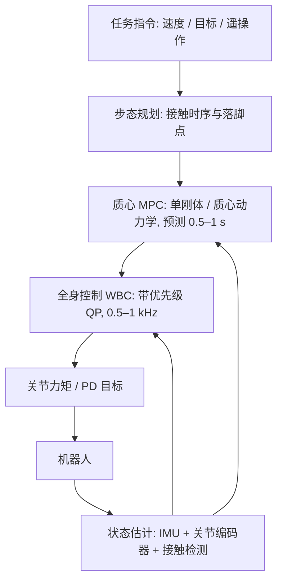

# 16 · 腿足与人形机器人：平衡、步态与全身控制

> 阅读目标：理解浮动基机器人“欠驱动 + 依赖接触”的本质；从质心动力学推出线性倒立摆、ZMP 与捕获点；了解模型预测控制与全身控制（WBC）的分层；以及强化学习行走策略和人形全身遥操作 / 动作重定向的接口。

## 1. 为什么腿足控制难

机械臂基座固定，关节力矩可直接决定末端运动；腿足和人形机器人的躯干（浮动基）没有执行器，只能通过脚与地面的接触力间接推动。接触是单边的（地面只能推不能拉）、受摩擦锥约束（12 章式 12.1），而且步态中接触不断切换。

|符号|含义|维数 / 单位|
|---|---|---|
|$q=[q_b;q_j]$|浮动基位姿 + 关节角|$6+n$（位姿常用四元数表示时为 7+n）|
|$S$|选择矩阵|$n\times(6+n)$，只有关节受驱动|
|$J_c,\lambda$|接触雅可比、接触力|每个点接触 3 维|
|$c,\dot c$|质心位置与速度|米、m/s|
|$L$|绕质心的角动量|kg·m²/s|
|$p$|ZMP / 压力中心|地面上的点|
|$z_c,\omega$|质心高度、倒立摆固有频率|$\omega=\sqrt{g/z_c}$|
|$\xi$|捕获点（发散运动分量）|地面坐标|

## 2. 浮动基动力学与质心动力学

$$M(q)\ddot q+h(q,\dot q)=S^\top\tau+J_c^\top\lambda.\tag{16.1}$$

前 6 行（浮动基部分）没有 τ，只能由接触力 λ 驱动。这 6 行恰好等价于牛顿—欧拉方程作用于整个机器人：

推导 1 · 质心动力学方程

把机器人看作质点系，总质量 m，第 i 个接触点位置 $p_i$、力 $f_i$。对质心应用牛顿第二定律，对质心取角动量定理：

$$m\ddot c=\sum_if_i+mg,\qquad\dot L=\sum_i(p_i-c)\times f_i.\tag{16.2}$$

关节内力成对抵消，不出现在式中，所以“只靠关节”无法改变质心运动，必须借助接触力。这组 6 维方程是许多 MPC 的简化模型：把接触力当作决策变量，满足摩擦锥约束，预测未来质心轨迹，再由全身控制把期望接触力转为关节力矩。

## 3. 线性倒立摆、ZMP 与捕获点

推导 2 · 从质心动力学到 LIPM

假设：质心高度恒定 $z_c$（$\ddot z=0$），绕质心角动量变化可忽略（$\dot L\approx0$），所有接触在平地 z=0。由竖直方向 $m\ddot z=f_z-mg=0$ 得 $f_z=mg$。由 $\dot L=0$ 的水平分量，合接触力必须指向质心，作用点（压力中心 p）与质心连线即力方向：

$$\frac{f_x}{f_z}=\frac{c_x-p_x}{z_c}\ \Rightarrow\ \ddot c_x=\frac{f_x}{m}=\frac g{z_c}(c_x-p_x)=\omega^2(c_x-p_x).\tag{16.3}$$

y 方向同理。这就是线性倒立摆模型（LIPM）：质心像倒立摆一样被“推离”压力中心，ω 决定发散速度。

**ZMP 判据**：压力中心只能位于支撑多边形（脚底接触区域的凸包）内，因为地面法向力非负。规划质心轨迹时要求对应的 $p=c-\ddot c/\omega^2$ 始终在支撑多边形内，这就是经典 ZMP 步行规划（Kajita 预观控制）的约束。

推导 3 · 捕获点：一步停下来要踩哪里

LIPM 的解可分解为收敛与发散两部分。定义 $\xi=c+\dot c/\omega$，对时间求导并代入式 (16.3)：

$$\dot\xi=\dot c+\frac{\ddot c}{\omega}=\dot c+\omega(c-p)=\omega\left(c+\frac{\dot c}\omega-p\right)=\omega(\xi-p).\tag{16.4}$$

ξ 只受 p 驱动且以 ω 指数发散；质心则以收敛方式跟随 ξ（$\dot c=\omega(\xi-c)$）。若把压力中心放在 ξ（一步踩到 ξ），则 $\dot\xi=0$，质心渐近停在 ξ 上方——ξ 因此称为捕获点（capture point）。

数值例：$z_c=0.9$ m，$\omega=\sqrt{9.81/0.9}\approx3.30\ \text{s}^{-1}$。被推后质心速度 0.5 m/s，则 $\xi-c=0.5/3.30\approx0.15$ m：需要在质心前方约 15 cm 落脚才能停下。若最大步长不足，需要多步或借助上身角动量（挥臂、弯腰）。

## 4. 分层控制架构

推导 4 · 全身控制作为二次规划

决策变量为广义加速度、接触力和关节力矩 $(\ddot q,\lambda,\tau)$。多个任务（质心加速度跟踪、躯干姿态、摆动脚轨迹、上肢操作）写成 $J_k\ddot q+\dot J_k\dot q=\ddot x_k^{des}$ 的加速度目标：

$$\begin{aligned}\min_{\ddot q,\lambda,\tau}\ &\sum_kw_k\left\|J_k\ddot q+\dot J_k\dot q-\ddot x_k^{des}\right\|^2+\epsilon\|\tau\|^2\\\text{s.t. }&M\ddot q+h=S^\top\tau+J_c^\top\lambda,\quad J_c\ddot q+\dot J_c\dot q=0,\\&\lambda\in\text{摩擦锥（棱锥线性化）},\quad\tau_{min}\le\tau\le\tau_{max}.\end{aligned}\tag{16.5}$$

第二个等式约束要求支撑脚不滑动。权重法简单但任务会互相妥协；严格优先级可用级联 QP（先解高优先级，再在其最优解集合内解低优先级）。期望任务加速度通常由 PD 形式给出 $\ddot x^{des}=\ddot x^{ref}+K_d(\dot x^{ref}-\dot x)+K_p(x^{ref}-x)$。

## 5. 强化学习行走：接口与要点

近年四足与人形的鲁棒行走多由仿真 RL 训练（见 11 章）：

|设计|常见选择|理由|
|---|---|---|
|观测|IMU 角速度、重力方向投影、关节位置 / 速度、上一动作、指令、步态相位|都可在实机测得|
|特权信息（教师）|地形高度图、摩擦、外力、接触状态|学生从历史推断|
|动作|关节目标偏移 $q^*=q_0+k\,a_t$|PD 跟踪，平滑稳定|
|频率|策略 50 Hz，PD 1 kHz 以上|策略推理与底层控制解耦|
|课程|地形难度随成功率提高|避免一开始就太难学不会|
|随机化|质量、摩擦、电机强度、延迟、外推|11 章表中的 Sim2Real 差距|

PD 关节力矩 $\tau=K_p(q^*-q)-K_d\dot q$ 让策略的输出具有“弹簧”语义：策略输出的是平衡点而非力矩。$K_p$ 过高会放大仿真—实机差距，过低则跟踪滞后。电机力矩—速度曲线、电流限制必须在仿真中建模。

## 6. 人形：全身遥操作、动作重定向与行走—操作结合

人形机器人的目标通常是在人类环境中同时行走与操作。数据来源包括动作捕捉、视频人体姿态估计、VR 遥操作。

推导 5 · 人体动作重定向到人形

人体模型（如 SMPL）给出关节位置序列 $\{P_k^{h}(t)\}$。人形正运动学 $P_k(q)$。先拟合形状缩放 s，再逐帧求解：

$$q_t^*=\arg\min_q\sum_kw_k\left\|P_k(q)-sP_k^h(t)\right\|^2+\beta\|q-q_{t-1}^*\|^2\quad\text{s.t. 关节限位}.\tag{16.6}$$

运动学上可行不等于动力学可行：人的动作可能超出电机力矩或使 ZMP 越出支撑区。因此常再训练一个 RL 跟踪策略，以重定向后的参考动作为目标、奖励跟踪误差，并在仿真中筛掉不可行片段。部署时遥操作者的动作实时重定向后作为跟踪策略的指令。

行走—操作结合（loco-manipulation）常用分层：下肢策略负责平衡与移动，上肢由遥操作、IK 或学习的操作策略控制；或训练统一的全身策略，以末端目标与基座速度为指令。手部灵巧操作见 12 章。

## 7. 局限与实践提示

- LIPM 假设恒高度与零角动量，跑跳、上下楼梯需要更完整的质心 / 单刚体模型。
- 状态估计（躯干速度、接触）是腿足系统的隐性瓶颈；打滑与软地面会使接触检测失效。
- 人形安全：跌倒保护、力矩限制、急停与悬吊测试必须先于算法实验。
- RL 策略难以给出稳定性证明；用于产品时常与模型控制器结合或加入安全监控。

来源：[Modern Robotics](https://modernrobotics.northwestern.edu/)、Kajita et al.《Introduction to Humanoid Robotics》（LIPM、ZMP 预观控制）、Pratt et al. (2006) Capture Point、Di Carlo et al. (IROS 2018) 凸 MPC、[Legged Gym 大规模并行 RL](https://arxiv.org/abs/2109.11978)、[ANYmal 复杂地形行走](https://arxiv.org/abs/2010.11251)、[H2O 人形全身遥操作](https://arxiv.org/abs/2403.04436)、[HumanPlus](https://arxiv.org/abs/2406.10454)。
