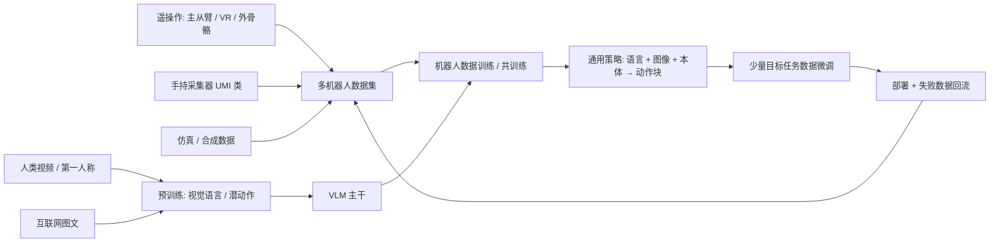
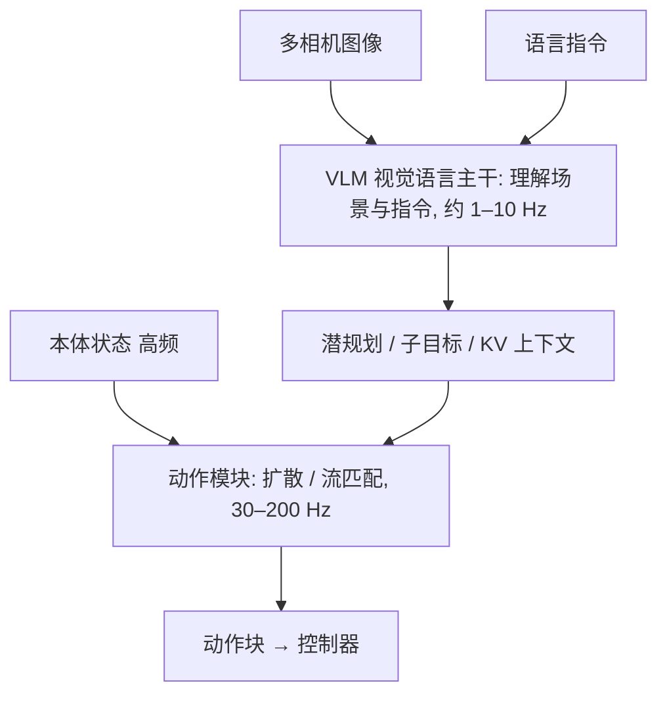

# 17 · 机器人基础模型：数据、动作表示与通用策略

> 阅读目标：理解通用机器人策略的三个支柱——数据（怎么采、怎么混）、动作表示（分块、离散化、扩散 / 流匹配）、架构（VLM 主干 + 动作专家、快慢双系统）；会推导 ACT 的时间集成、流匹配动作头与 DCT 动作分词；知道怎样公平评测通用策略。本章是 06 章 VLA 的扩展。

## 1. 全景

## 2. 符号

|符号|含义|约定|
|---|---|---|
|$o_t=(I_t^{1..V},q_t,\ell)$|多相机图像、本体状态、语言指令|V 个相机|
|$A_t=a_{t:t+H-1}$|动作块|$H\times d_a$|
|$\tau\in[0,1]$|流匹配时间|与环境时间 t 区分|
|$v_\theta$|速度场网络（动作专家）|输出与 $A$ 同形状|
|$z$|CVAE 风格潜变量|ACT 中编码演示风格|
|$m$|时间集成衰减系数|ACT 中权重 $e^{-mi}$|
|$e$|embodiment 标识|机器人类型 / 动作空间|

## 3. 数据：采集方式与混合

|方式|优点|局限|
|---|---|---|
|主从臂遥操作（ALOHA 类）|直观、可做双臂精细动作，动作空间与机器人一致|需要实体机器人，采集速度受限|
|VR / 手部追踪|远程、可扩展到人形|视觉延迟，力反馈弱|
|手持采集器（UMI）|无需机器人，可在任意场景采集|需相机位姿估计，动作要映射到具体机械臂|
|人类视频|规模巨大、场景多样|无动作标签，形态差异|
|仿真生成|无限、可自动标注|Sim2Real 差距，资产多样性|

推导 1 · 数据混合权重与有效样本

多个数据集 $D_1..D_K$ 混合训练，按权重 $w_k$ 采样，目标为 $\sum_kw_k\mathbb E_{D_k}[\ell]$。若直接按样本数比例采样，大数据集主导；Open X-Embodiment 等工作按数据集手动或启发式调整权重，并对单一数据集内的重复轨迹降权。

一个常用启发式是温度采样：$w_k\propto n_k^{1/T}$，T=1 按样本数，T→∞ 均匀。另一个关注点是“多样性比数量更重要”：模仿学习的数据规模研究发现，泛化到新环境与新物体时，增加环境与物体的种类比在同一环境内堆叠演示数量更有效，且每个环境—物体组合只需少量演示。规划采集时应先覆盖多样性，再加密。

数据质量检查：动作与图像时间戳对齐、坐标系与单位一致（06 章动作适配器）、去除失败与停顿片段（或保留并标注）、记录相机内外参与夹爪类型。

## 4. 动作分块与 ACT

ACT（Action Chunking with Transformers）一次预测 H 步动作，降低决策频率带来的复合误差（06 章式 6.3 中有效步数 T 变为 T/H），并用 CVAE 处理人类演示的多样性。

推导 2 · CVAE 损失与时间集成

训练时编码器从（本体状态、演示动作块）推断风格潜变量 $z\sim q_\phi(z\mid A,q)$，解码器从（图像、本体、z）重建动作块。损失为 L1 重建加 KL：

$$L_{ACT}=\left\|A_t-\hat A_t(o_t,z)\right\|_1+\beta\,D_{KL}\left(q_\phi(z\mid A_t,q_t)\,\|\,\mathcal N(0,I)\right).\tag{17.1}$$

部署时 z 取先验均值 0，得到确定性输出。每一步都推理一次，则时刻 t 有来自过去多个推理的重叠预测 $\hat a_t^{(t-i)}$（i 步之前那次推理对 t 的预测）。时间集成按指数权重平均：

$$a_t=\frac{\sum_iw_i\hat a_t^{(t-i)}}{\sum_iw_i},\quad w_i=\exp(-m\,i).\tag{17.2}$$

ACT 原文中 $w_0$ 对应最早的预测，权重随新旧变化的方向由 m 的符号与索引约定决定；实现时需确认“越新越重”还是“越旧越重”。m 越大越依赖单次预测（响应快），m 越小越平滑（可能滞后）。这与 06 章“只执行前 $H_e$ 步”的滚动执行是两种不同的块使用策略。

## 5. 动作表示：离散 token、扩散与流匹配

|表示|代表|推理方式|优缺点|
|---|---|---|---|
|逐维均匀分箱|RT-2、OpenVLA|自回归逐 token|复用 LLM 词表；高频长动作块 token 多、慢|
|压缩分词（DCT + BPE）|FAST|自回归|token 少、适合高频；需解码回连续|
|扩散头|Diffusion Policy、Octo|多步去噪|多模态好；采样步数影响延迟|
|流匹配头|π0 类|ODE 积分约 10 步|训练稳定、步数少；需数值积分|
|回归 + 分块|ACT|一次前向|快；多模态依赖 CVAE|

推导 3 · 流匹配动作头

取噪声 $\epsilon\sim\mathcal N(0,I)$ 与专家动作块 $A$，沿直线插值（本讲义约定 τ=0 为噪声、τ=1 为数据）：

$$A^\tau=\tau A+(1-\tau)\epsilon,\qquad\frac{dA^\tau}{d\tau}=A-\epsilon.\tag{17.3}$$

条件速度场的回归目标就是这个常速度。网络 $v_\theta(A^\tau,\tau,o)$ 最小化

$$L_{FM}=\mathbb E_{\tau,\epsilon,(o,A)}\left\|v_\theta(A^\tau,\tau,o)-(A-\epsilon)\right\|^2.\tag{17.4}$$

推理从 $A^0\sim\mathcal N(0,I)$ 出发用欧拉法积分：$A^{\tau+\delta}=A^\tau+\delta\,v_\theta(A^\tau,\tau,o)$，δ=0.1 时 10 步。与 02 章 Flow Matching 的条件路径一致；不同论文对 τ 方向（噪声在 0 还是 1）与目标符号约定不同，复现时以代码为准。π0 的设计是把图像与语言交给预训练 VLM 处理，再用一个较小的“动作专家”Transformer 处理本体状态与带噪动作 token，两者通过注意力共享上下文；τ 的采样分布偏向噪声较大的区域以强调难样本。

推导 4 · DCT 动作分词为何压缩高频动作

对动作块的每一维 $a_{0..H-1}$ 做 DCT-II：

$$C_k=\sum_{n=0}^{H-1}a_n\cos\left[\frac\pi H\left(n+\tfrac12\right)k\right],\quad k=0..H-1.\tag{17.5}$$

平滑轨迹的能量集中在低频系数，高频系数接近 0。把 $C_k$ 乘尺度后取整，大量高频项变为 0；再把所有维度的系数按“低频优先”展平并用 BPE 合并常见模式，得到远少于 $H\times d_a$ 的 token。解码时逆 DCT 恢复连续动作。对比式 (6.7) 的逐维分箱：50 Hz、1 秒动作块、7 维即 350 个 token，而压缩后通常只需几十个。量化尺度决定重建误差与 token 数的权衡。

## 6. 通用策略架构

|模型族|主干|动作部分|特点|
|---|---|---|---|
|RT-1 / RT-2|EfficientNet+Transformer / VLM|离散 token|RT-2 与网络图文共训练，迁移语义知识|
|Octo|Transformer（从头训练）|扩散头|开源，支持多相机、多动作空间，便于微调|
|OpenVLA|Llama 2 + DINOv2/SigLIP 视觉|256 箱离散 token|开源 7B，LoRA 微调|
|π0 / π0-FAST|PaliGemma VLM|流匹配动作专家 / FAST token|跨形态、多任务、高频灵巧动作|
|RDT|扩散 Transformer|扩散|双臂、统一动作空间|
|GR00T N1 等双系统|VLM（慢，System 2）+ 动作模块（快，System 1）|扩散 / 流|面向人形，推理频率分离|

跨形态（cross-embodiment）的关键是动作空间对齐：统一为末端位姿增量 + 夹爪，或使用最大维度向量并对未用维度 mask；每个样本携带 embodiment 标识与归一化统计。归一化统计必须按机器人分别计算并随模型保存，否则部署时同一数值对应不同物理量。

## 7. 评测：仿真基准与实机统计

|基准|环境|考察|
|---|---|---|
|LIBERO|仿真桌面操作|空间、物体、目标与长时任务的迁移|
|CALVIN|仿真|语言条件长时任务链|
|SIMPLER|仿真复刻真实场景|与真实评测结果的相关性|
|实机评测|自建|成功率、干预、时间、安全事件|

推导 5 · 配对比较两个策略

A、B 两策略在同一组 n 个初始条件（物体摆放、指令）下各跑一次。只看“结果不一致”的配对：A 成 B 败计 $n_{10}$，A 败 B 成计 $n_{01}$。在“两者成功率相同”的原假设下，不一致配对中 A 赢的次数服从 $\operatorname{Binomial}(n_{10}+n_{01},0.5)$，精确符号检验（McNemar 精确版）的 p 值为

$$p=2\sum_{k=0}^{\min(n_{10},n_{01})}\binom{n_{10}+n_{01}}{k}0.5^{n_{10}+n_{01}},\ \text{上限取 }1.\tag{17.6}$$

例：30 个初始条件中 $n_{10}=8,n_{01}=2$，p≈0.11，尚不足以下结论。配对设计消除了初始条件难度的差异，比两组独立试验更省次数。单策略成功率的置信区间用 08 章 Wilson 区间。

报告时同时给出：训练与测试的物体 / 场景 / 指令是否见过（seen / unseen 分层）、每条失败的类别（grounding、抓取、放置、碰撞、超时）、推理延迟分布与控制频率，以及微调所用的目标任务演示数量。

## 8. 局限与开放问题

- 数据仍是最大瓶颈：遥操作昂贵，人类视频缺动作，仿真缺多样资产与真实接触。
- 动作空间不统一使跨形态迁移有限，常需目标机器人上的微调数据。
- 长时任务、失败恢复与安全约束仍依赖外部规划和监控。
- 基准结果对评测协议敏感；不同论文的“成功”定义与试验次数应先对齐再比较。

来源：[RT-1](https://arxiv.org/abs/2212.06817)、[RT-2](https://arxiv.org/abs/2307.15818)、[ALOHA / ACT](https://arxiv.org/abs/2304.13705)、[Mobile ALOHA](https://arxiv.org/abs/2401.02117)、[UMI](https://arxiv.org/abs/2402.10329)、[Open X-Embodiment](https://arxiv.org/abs/2310.08864)、[Octo](https://arxiv.org/abs/2405.12213)、[OpenVLA](https://arxiv.org/abs/2406.09246)、[π0](https://arxiv.org/abs/2410.24164)、[FAST](https://arxiv.org/abs/2501.09747)、[RDT](https://arxiv.org/abs/2410.07864)、[GR00T N1](https://arxiv.org/abs/2503.14734)、[模仿学习数据规模规律](https://arxiv.org/abs/2410.18647)、[LIBERO](https://arxiv.org/abs/2306.03310)、[CALVIN](https://arxiv.org/abs/2112.03227)、[SIMPLER](https://arxiv.org/abs/2405.05941)。模型细节以原文与官方代码为准，本章不提供性能排行。
